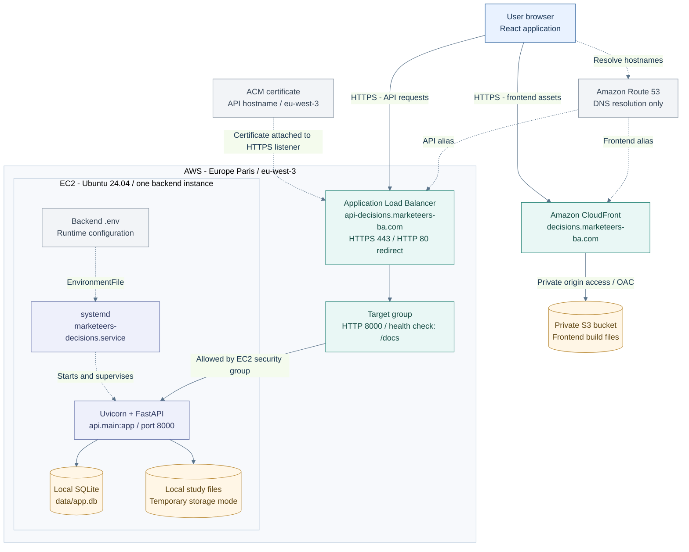
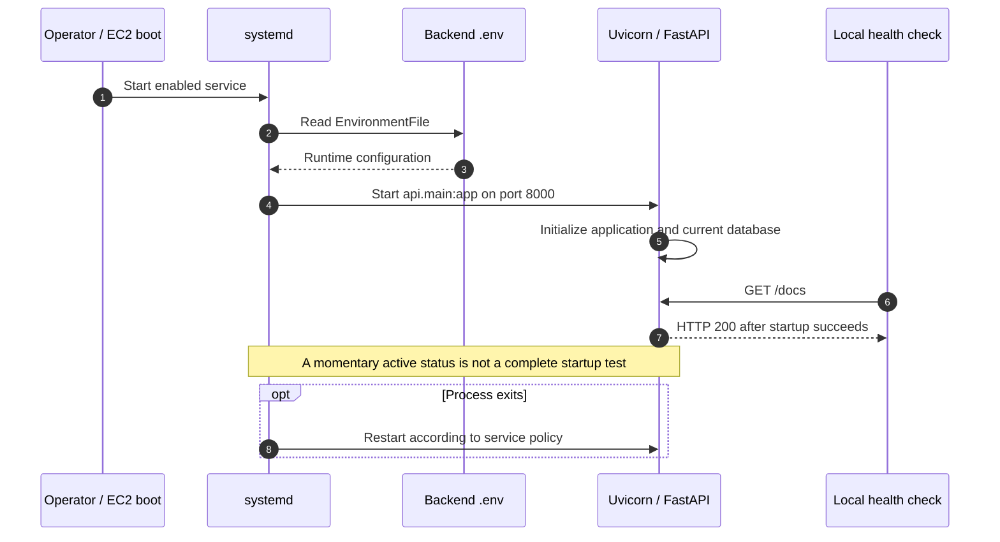
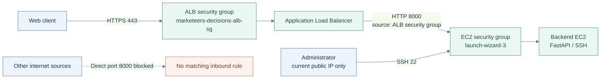
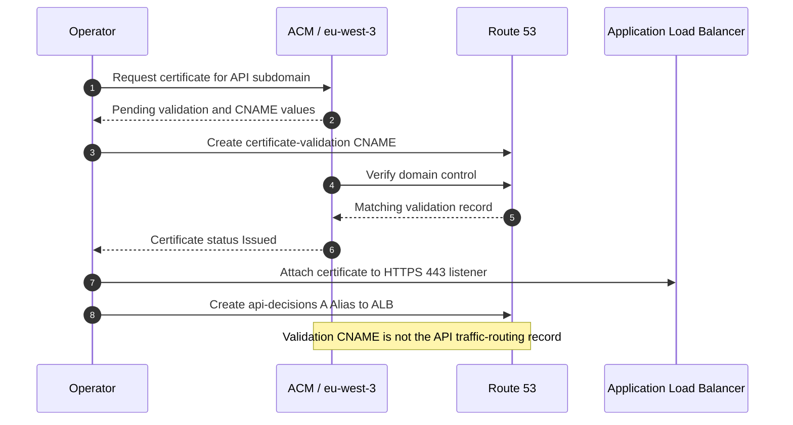
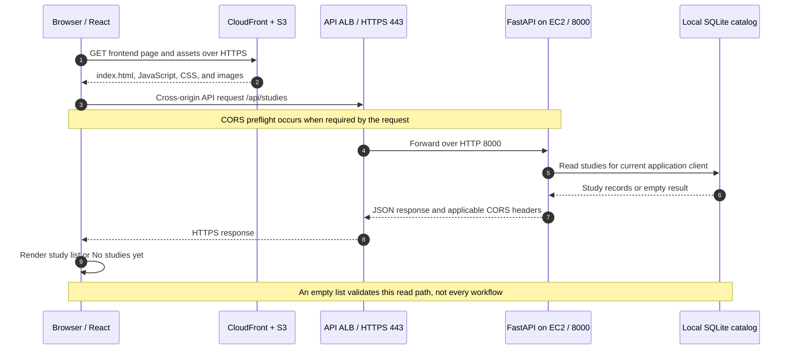
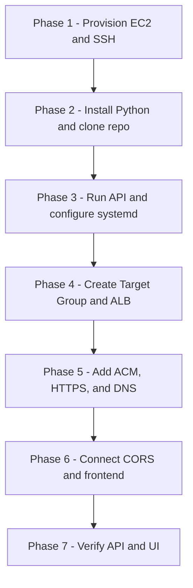
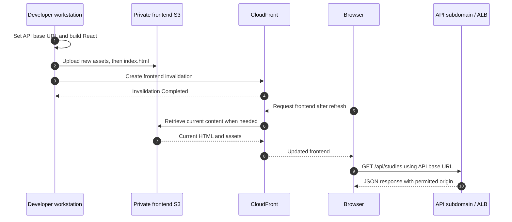

# Marketeers Decisions - AWS Backend Deployment

**Architecture reference + step-by-step process SOP**

| Document control | Value |
| --- | --- |
| Version | 1.0 |
| Deployment record | 5-7 October 2026 |
| Audience | Developers and team members repeating or maintaining the deployment |
| Backend | Python / FastAPI / Uvicorn |
| Hosting | Ubuntu EC2 behind an Application Load Balancer |
| AWS Region | Europe (Paris), `eu-west-3` |
| Frontend | `https://decisions.marketeers-ba.com` |
| API | `https://api-decisions.marketeers-ba.com` |
| Scope | Backend deployment and integration with the existing frontend |

> **Current status:** Infrastructure connectivity and the Data Hub empty-state screen were demonstrated. Study import, simulation, optimization, recovery, and production authorization have not been accepted through end-to-end testing.
>
> **External-release gate:** The recorded configuration still uses `MARKET_SIM_AUTH=dev`. HTTPS, an ALB, and CORS do not replace application authentication or tenant authorization. Do not use this deployment for sensitive customer data until those controls are implemented and verified. Moving to RDS or S3 will not, by itself, resolve authentication.

## Contents

- [Part I - Architecture and deployment reference](#part-i)
- [Part II - Step-by-step deployment process](#part-ii)
  - [Phases 1-6: EC2, SSH, Python, and application setup](#phase-1)
  - [Phases 7-9: Local test, environment, and systemd](#phase-7)
  - [Phases 10-13: Target group, security groups, and ALB](#phase-10)
  - [Phases 14-18: Certificate, HTTPS, DNS, and API verification](#phase-14)
  - [Phases 19-23: CORS, frontend integration, release, and smoke tests](#phase-19)
- [Appendix A - Troubleshooting](#appendix-a)
- [Appendix B - Recorded resource inventory](#appendix-b)
- [Appendix C - Handover and next phase](#appendix-c)

**Diagram format:** Diagrams are editable Mermaid code blocks. View the document in a Markdown renderer that supports Mermaid to display them graphically. The reference image supplied for diagram style does not change the application database: this deployment uses SQLite temporarily, with PostgreSQL/RDS planned, not MongoDB Atlas.

<a id="part-i"></a>
# Part I - Architecture and deployment reference

## 1. Purpose and use cases

This reference explains the deployment that was implemented, what each component does, and the boundaries of the current setup. Part II gives the repeatable execution procedure.

| Use case | How to use this document |
| --- | --- |
| Repeat the backend deployment for Marketeers Decisions | Follow Part II and use the resource inventory to identify existing resources. Do not create duplicates unintentionally. |
| Deploy another FastAPI application | Reuse the process, but replace the repository, entry point, names, ports, domains, environment variables, and health endpoint with that application's values. |
| Diagnose a failed deployment | Follow Appendix A and test the layers separately: process, target health, listener, DNS/TLS, and browser API calls. |
| Deploy a static frontend only | Use the separate frontend SOP. S3 and CloudFront do not run this Python backend. |
| Deploy for external customer use | Complete the security and functional release gates; infrastructure connectivity alone is insufficient. |

### Responsibility split

| Component | Responsibility in this deployment |
| --- | --- |
| EC2 | Runs the Python application and currently holds local application data. |
| Python virtual environment | Separates application dependencies from system Python. |
| Uvicorn | Runs the FastAPI ASGI application on port `8000`. |
| systemd | Starts and supervises Uvicorn, including startup after boot. |
| Application Load Balancer (ALB) | Accepts public HTTP/HTTPS connections and forwards HTTPS-originated requests to the target group. |
| Target group | Registers the EC2 backend and checks its configured health endpoint. |
| Security groups | Control permitted network traffic to the ALB and EC2. |
| AWS Certificate Manager (ACM) | Supplies the certificate presented by the ALB for the API hostname. |
| Route 53 | Resolves the API hostname to the ALB; it is not an HTTP proxy. |
| CORS middleware | Controls which browser origins may read cross-origin API responses. |
| S3 + CloudFront | Serve the existing React frontend, separately from the backend. |

## 2. Architecture overview



**Read the arrows correctly:** Solid arrows show content or application-data access. Dotted arrows show DNS, certificate association, or process/configuration relationships. The browser calls the API directly on its API subdomain; its API requests do not pass through the frontend S3 bucket.

The ALB spans two Availability Zones, but the application currently has only one EC2 target. This is not a multi-instance, highly available application deployment.

## 3. EC2 configuration

| Setting | Recorded value |
| --- | --- |
| Name | `Marketeers-Decisions-Backend` |
| Operating system | Ubuntu Server 24.04 LTS, x86_64 |
| Instance type | `t3.micro` |
| Application account | `ubuntu` |
| Backend directory | `/home/ubuntu/Marketeers-Decisions/backend` |
| Volume | 20 GiB, `gp3` |
| Application port | TCP `8000` |
| Administrative access | SSH on TCP `22`, limited to the administrator's public IP |

`t3.micro` was chosen for the initial deployment, not as a demonstrated capacity recommendation. No user-count or optimization-throughput benchmark has been completed.

> **Cost and storage caveats:** A console label such as "Free tier eligible" does not establish this account's remaining allowance. Check account billing before repeating the deployment. The launch screenshots showed the root volume as **Not encrypted**; no later change was evidenced. Enable encryption for a new deployment and resolve the existing volume's encryption requirement before storing sensitive data.

## 4. Python runtime and dependencies

The recorded server reported Python `3.12.3`. The application virtual environment is:

```text
/home/ubuntu/Marketeers-Decisions/backend/.venv
```

Dependencies were installed from `backend/requirements.txt`, including FastAPI, Uvicorn, SQLAlchemy, Alembic, psycopg, pandas, NumPy, openpyxl, Parquet libraries, and boto3.

```bash
python -m pip install -r requirements.txt
```

The requirements file uses minimum versions. A later clean install may therefore resolve different package versions. Record the deployed commit and installed package versions during handover rather than assuming an identical environment.

## 5. FastAPI entry point

The established ASGI import target is:

```text
api.main:app
```

The command must run with the backend directory as its working directory:

```bash
uvicorn api.main:app --host 0.0.0.0 --port 8000
```

Binding to `0.0.0.0` lets the application accept connections through the EC2 network interface. Network access is constrained separately by the EC2 security group. The recorded rule permits port `8000` from the ALB security group, not from all internet addresses.

## 6. systemd service

Service definition:

```text
/etc/systemd/system/marketeers-decisions.service
```

Recorded configuration:

```ini
[Unit]
Description=Marketeers Decisions FastAPI
After=network.target

[Service]
User=ubuntu
WorkingDirectory=/home/ubuntu/Marketeers-Decisions/backend
EnvironmentFile=/home/ubuntu/Marketeers-Decisions/backend/.env
Environment="PATH=/home/ubuntu/Marketeers-Decisions/backend/.venv/bin"
ExecStart=/home/ubuntu/Marketeers-Decisions/backend/.venv/bin/uvicorn api.main:app --host 0.0.0.0 --port 8000
Restart=always
RestartSec=5

[Install]
WantedBy=multi-user.target
```

systemd is a supervisor, not another HTTP forwarding layer. It launches Uvicorn with the working directory and environment shown above.



Before handing over from a manual Uvicorn process to systemd, stop the manual process. Two processes cannot both bind the same listening address and port. Do not treat an immediate `active (running)` display as proof of stable application health; inspect logs and confirm an HTTP response.

## 7. Environment configuration

The recorded `.env` contains:

```dotenv
APP_ENV=production
MARKET_SIM_STORAGE=local
MARKET_SIM_AUTH=dev
MARKET_SIM_DEV_CLIENT_ID=local-dev

DATABASE_URL=sqlite:///./data/app.db

MARKET_SIM_DECIMALS=2
```

| Variable | Recorded role |
| --- | --- |
| `APP_ENV` | Application environment label; setting it to `production` does not implement missing authentication. |
| `MARKET_SIM_STORAGE` | Keeps study-file storage local while the storage phase is deferred. |
| `MARKET_SIM_AUTH` | Retains the implemented development authentication path temporarily. |
| `MARKET_SIM_DEV_CLIENT_ID` | Uses the shared development client identity. |
| `DATABASE_URL` | Selects the local SQLite catalog under the backend working directory. |
| `MARKET_SIM_DECIMALS` | Controls display formatting. |

Do not invent an alternative authentication value without checking the code. The inspected middleware and dependency code specifically handled `dev`; production token verification and tenant checks require separate implementation.

Keep `.env` out of Git and restrict its file permissions. The browser-facing `VITE_API_BASE_URL` is a public endpoint setting, not a place for backend secrets.

## 8. Application Load Balancer

| Setting | Recorded value |
| --- | --- |
| Name | `marketeers-decisions-alb` |
| Type | Application |
| Scheme | Internet-facing |
| IP address type | IPv4 |
| VPC | `vpc-b5fa0bdd` |
| Availability Zones | `eu-west-3a` and `eu-west-3b` |
| HTTPS listener | `443`, forwards to the backend target group |
| HTTP listener | `80`, redirects to HTTPS `443` with HTTP `301` |

TLS terminates at the ALB. The recorded ALB-to-EC2 hop uses HTTP on port `8000`; this is not end-to-end TLS to the Python process.

## 9. Target group

| Setting | Recorded value |
| --- | --- |
| Name | `marketeers-decisions-backend-tg` |
| Target type | Instance |
| Protocol / port | HTTP / `8000` |
| Protocol version | HTTP1 |
| Registered targets | One: `Marketeers-Decisions-Backend` |
| Observed health | Healthy |

A target can appear `Unused` before the target group is associated with the load balancer listener. After association, connectivity, the enabled Availability Zone, and health-check responses determine its health.

## 10. Health-check boundaries

The configured HTTP health-check path is `/docs`.

This proved that the target could respond to the configured endpoint. It did **not** prove that study upload, simulation, optimizer jobs, tenant isolation, or data recovery work correctly.

A dedicated application health endpoint can be evaluated later. Do not switch the path to an endpoint that does not exist or require every dependency to be declared healthy based only on Swagger availability.

## 11. Security groups

| Attached to | Inbound port | Source | Purpose |
| --- | --- | --- | --- |
| ALB | TCP `80` | `0.0.0.0/0` | HTTP-to-HTTPS redirect |
| ALB | TCP `443` | `0.0.0.0/0` | Public HTTPS endpoint |
| EC2 | TCP `22` | Administrator's current public IPv4 `/32` | SSH administration |
| EC2 | TCP `8000` | `marketeers-decisions-alb-sg` | Backend and health-check traffic from the ALB |

The recorded groups retain default outbound access. This is a record of the implemented setup, not a claim of least-privilege outbound hardening.



For restricted testing while authentication remains unfinished, review the ALB's exposure policy with the application owner. Restricting EC2 port `8000` to the ALB does not restrict who can use the public ALB API.

## 12. HTTPS and certificates

The API certificate covers `api-decisions.marketeers-ba.com` and was issued in `eu-west-3`, the ALB's Region.

The existing frontend certificate used with CloudFront is separate and was created in `us-east-1`.

| Item | API configuration |
| --- | --- |
| Certificate source | ACM |
| Domain validation | DNS CNAME in Route 53 |
| Key algorithm | RSA 2048 |
| Observed status | Issued |
| Listener policy | Recommended policy selected in the console at deployment |
| Mutual TLS | Not enabled |

The validation CNAME and the API routing record are different records. The CNAME proves domain control; the `api-decisions` A Alias routes requests to the ALB. Preserve the validation record for certificate management.



## 13. Route 53

The configured API record is:

```text
Hosted zone: marketeers-ba.com
Record name: api-decisions
Record type: A
Alias: Yes
Target: marketeers-decisions-alb
Region: Europe (Paris)
Routing policy: Simple
Evaluate target health: Yes
```

Use the load balancer alias, not an EC2 public IP, for this API endpoint. The selected ALB is IPv4; this procedure creates an A Alias, not an additional AAAA record.

## 14. CORS

Frontend and API have different origins. The recorded middleware uses `DEV_ORIGINS` in `backend/api/main.py`:

```python
DEV_ORIGINS = [
    "http://localhost:5173",
    "http://127.0.0.1:5173",
    "https://decisions.marketeers-ba.com",
]
```

The existing wildcard entry was removed. The variable's legacy name was retained; this document does not imply that `APP_ENV` automatically changes the list.

CORS is a browser response-access policy, not a login system or API authorization mechanism.

## 15. Frontend API configuration

Local production-build configuration:

```text
frontend/.env.production
```

```dotenv
VITE_API_BASE_URL=https://api-decisions.marketeers-ba.com
```

The central client constructs API URLs, preserving existing paths such as `/api/studies`. The base URL has neither a trailing slash nor an extra `/api` suffix.

| Mode | Request behavior |
| --- | --- |
| Local development with empty base | `/api/...` uses the existing Vite development proxy. |
| Deployed production build | API base + `/api/...` addresses the API subdomain directly. |

All four fetch paths in `src/api/client.ts` were in scope: ordinary JSON requests, uploads, downloads, and POST downloads. Editing only the first fetch would leave other flows pointing to the frontend origin.

## 16. End-to-end request sequence




# Part II - Step-by-step deployment process

## How to execute this SOP

Every step identifies where to perform the action:

| Label | Where to run the action |
| --- | --- |
| **AWS Console** | Browser signed in to the correct AWS account. |
| **LOCAL - PowerShell** | Windows workstation; prompt begins with `PS`. |
| **EC2 - SSH** | Ubuntu server session; prompt begins with `ubuntu@...`. |
| **Browser test** | A normal browser or browser developer tools. |

A filename such as `.env.production` is not a terminal command. Paths containing spaces must be quoted in PowerShell. The recorded Windows folders are spelled `Bullding Apps` and `Pltaform`; retain those spellings for this workstation, or use the actual path on another workstation.

The commands below configure resources. Use the correct account and instance, protect credentials, and avoid changing existing applications belonging to other teams.



<a id="phase-1"></a>
## Phase 1 - Create the EC2 server

### Step 1 - Open the launch screen

**Where: AWS Console**

1. Select **Europe (Paris), eu-west-3**.
2. Open **EC2 > Instances > Launch instances**.
3. Confirm that this is the intended account and Region.

**Expected result:** The EC2 launch form is displayed.

### Step 2 - Configure the instance and its network

**Where: AWS Console - EC2 launch form**

| Field | Value |
| --- | --- |
| Name | `Marketeers-Decisions-Backend` |
| AMI | Ubuntu Server 24.04 LTS |
| Architecture | 64-bit x86 / amd64 |
| Instance type | `t3.micro` for initial setup only |
| Number of instances | `1` |
| VPC | The deployment VPC; recorded value `vpc-b5fa0bdd` |
| Auto-assign public IP | Enabled for the recorded direct-SSH setup |
| Security group | Create a group for this instance |
| SSH source | **My IP**, not Anywhere |
| Allow HTTP from internet | Unchecked |
| Allow HTTPS from internet | Unchecked |
| Root storage | 20 GiB, `gp3` |
| Additional file system | None |

For a new deployment, enable EBS encryption before launch. The earlier walkthrough did not demonstrate that this was done.

**Do not launch until Step 3 is complete.** The instance does not need an internet-wide port `8000` rule at any point.

### Step 3 - Create and save the key pair, then launch

**Where: AWS Console and local workstation**

1. Under **Key pair (login)**, choose **Create new key pair**.
2. Name it `marketeers-decisions-backend-key`.
3. Choose **RSA** and **.pem**.
4. Save the downloaded file outside the Git repository.
5. Confirm that the new key pair is selected in the launch form.
6. Review the instance settings and choose **Launch instance**.
7. Open the new instance. Confirm **Running** and inspect its status checks.
8. Record its instance ID, public IPv4 address, security group, and key-pair name.

Recorded key location:

```text
D:\Bullding Apps\Pltaform\AWS-Keys\marketeers-decisions-backend-key.pem
```

Never upload the private key to S3, GitHub, a shared document, or a chat. Use approved secure credential handling for team access.

## Phase 2 - Configure SSH access

### Step 4 - Restrict the Windows private-key permissions

**Where: LOCAL - PowerShell**

```powershell
cd "D:\Bullding Apps\Pltaform\AWS-Keys"
icacls ".\marketeers-decisions-backend-key.pem" /inheritance:r
icacls ".\marketeers-decisions-backend-key.pem" /grant:r "$($env:USERNAME):(R)"
icacls ".\marketeers-decisions-backend-key.pem" /remove "NT AUTHORITY\Authenticated Users"
icacls ".\marketeers-decisions-backend-key.pem" /remove "BUILTIN\Users"
```

These commands resolved the permissions error encountered on the recorded Windows workstation. Group names may differ on another Windows installation; inspect the actual file permissions if the same error remains. Do not modify permissions recursively across unrelated folders.

### Step 5 - Connect to the correct EC2 instance

**Where: LOCAL - PowerShell**

Copy **Public IPv4 address** from the intended EC2 instance, then use:

```powershell
cd "D:\Bullding Apps\Pltaform\AWS-Keys"
$InstanceIp = Read-Host "Paste the EC2 Public IPv4 address"
ssh -i ".\marketeers-decisions-backend-key.pem" "ubuntu@$InstanceIp"
```

The recorded address was `15.224.222.31`; verify it in EC2 before reuse. Do not type `<PUBLIC-IP>` literally.

On the first connection, verify the SSH host identity using the team's trusted verification procedure before accepting the host-key prompt.

**Expected result:** A server prompt such as:

```text
ubuntu@ip-172-31-5-7:~$
```

### Step 6 - Maintain the permitted SSH source IP

**Where: AWS Console, when SSH times out**

1. Confirm that the instance is running and that its public address still matches the command.
2. Open **Instance > Security > security group > Edit inbound rules**.
3. In the **SSH / 22** row, choose **My IP** to update the administrator's source address.
4. Save and retry SSH.
5. Leave the later **8000 from ALB security group** rule unchanged.

The source-IP update restored SSH connectivity during the walkthrough. A timeout alone does not prove that the IP changed; investigate other network or server causes if this does not resolve it.

## Phase 3 - Prepare the server

### Step 7 - Refresh Ubuntu package metadata

**Where: EC2 - SSH**

```bash
sudo apt update
```

This refreshes package information. It does not install every available operating-system update. Review outstanding security updates and any restart requirement before release; do not run `do-release-upgrade` merely because the login banner suggests it.

### Step 8 - Install system prerequisites

**Where: EC2 - SSH**

```bash
sudo apt install -y git python3 python3-venv python3-pip build-essential
python3 --version
git --version
```

**Expected result:** The commands finish without installation errors. The recorded versions were Python `3.12.3` and Git `2.43.0`.

## Phase 4 - Retrieve the application

### Step 9 - Clone the repository

**Where: EC2 - SSH**

```bash
cd ~
git clone https://github.com/MarketeersBA/Marketeers-Decisions.git
cd ~/Marketeers-Decisions/backend
```

For an existing checkout, inspect its state rather than cloning over it:

```bash
git status --short
git rev-parse HEAD
```

Record the commit used. If repository access requires authentication, use approved access rather than pasting a token into commands or documentation.

## Phase 5 - Create the Python environment

### Step 10 - Create and activate the virtual environment

**Where: EC2 - SSH, backend directory**

```bash
python3 -m venv .venv
source .venv/bin/activate
python --version
python -m pip --version
```

**Expected result:** The prompt includes `(.venv)`, and pip's location is under `backend/.venv`.

### Step 11 - Install application dependencies

**Where: EC2 - SSH, activated virtual environment**

```bash
python -m pip install -r requirements.txt
```

Do not proceed past unresolved installation errors. The presence of both `requirements.txt` and `pyproject.toml` does not mean both installation approaches must be executed; the walkthrough used the requirements file.

## Phase 6 - Confirm the application entry point

### Step 12 - Inspect the entry point

**Where: EC2 - SSH**

```bash
ls api
grep -n 'FastAPI\|create_app\|app =' api/main.py
```

The entry point that was successfully started in this repository is `api.main:app`. For another project, confirm the exported ASGI application rather than assuming the filename is sufficient.

<a id="phase-7"></a>
## Phase 7 - Test the backend locally

### Step 13 - Start Uvicorn and test from a second SSH session

**Where: EC2 - SSH, session A**

```bash
cd ~/Marketeers-Decisions/backend
source .venv/bin/activate
uvicorn api.main:app --host 0.0.0.0 --port 8000
```

The first startup logged Alembic initialization of the SQLite schema. A migration log is not by itself proof that startup completed.

**Where: EC2 - SSH, session B**

Open another local PowerShell window, connect using Step 5, and run:

```bash
curl -i http://127.0.0.1:8000/docs
curl -sS -o /dev/null -w 'HTTP %{http_code}\n' http://127.0.0.1:8000/openapi.json
```

**Expected result:** The local endpoints respond successfully; `/docs` returns HTTP `200`.

> **Before starting systemd:** Return to session A and press **Ctrl+C** to stop the manual Uvicorn process. Leave the SSH session open if needed. Verify that no old manual process still owns port `8000`:
>
> ```bash
> sudo ss -ltnp 'sport = :8000'
> ```
>
> If a listener remains, identify its process before proceeding. Do not terminate unrelated Python services.

## Phase 8 - Configure runtime environment

### Step 14 - Review the template and supported settings

**Where: EC2 - SSH**

```bash
cd ~/Marketeers-Decisions/backend
cat .env.example
grep -n 'APP_ENV\|MARKET_SIM_AUTH\|DATABASE_URL\|MARKET_SIM_STORAGE' config.py api/deps.py api/middleware.py
```

Do not share a real `.env` containing credentials. Review the example and relevant code without exposing secrets.

### Step 15 - Create the temporary environment file

**Where: EC2 - SSH**

```bash
nano .env
```

Enter the configuration used during this deployment:

```dotenv
APP_ENV=production
MARKET_SIM_STORAGE=local
MARKET_SIM_AUTH=dev
MARKET_SIM_DEV_CLIENT_ID=local-dev
DATABASE_URL=sqlite:///./data/app.db
MARKET_SIM_DECIMALS=2
```

Save with **Ctrl+O > Enter**, then exit with **Ctrl+X**. Protect the file:

```bash
chmod 600 .env
```

**Boundary:** These settings preserve the current local test setup. They are not a completed production-security configuration, and they do not provision RDS or S3.

## Phase 9 - Configure systemd

### Step 16 - Create the service file

**Where: EC2 - SSH**

```bash
sudo nano /etc/systemd/system/marketeers-decisions.service
```

Paste:

```ini
[Unit]
Description=Marketeers Decisions FastAPI
After=network.target

[Service]
User=ubuntu
WorkingDirectory=/home/ubuntu/Marketeers-Decisions/backend
EnvironmentFile=/home/ubuntu/Marketeers-Decisions/backend/.env
Environment="PATH=/home/ubuntu/Marketeers-Decisions/backend/.venv/bin"
ExecStart=/home/ubuntu/Marketeers-Decisions/backend/.venv/bin/uvicorn api.main:app --host 0.0.0.0 --port 8000
Restart=always
RestartSec=5

[Install]
WantedBy=multi-user.target
```

Save to the exact `.service` path. In nano, **Ctrl+X** is a keyboard shortcut, not a character to append to the filename.

### Step 17 - Enable, start, and verify the service

**Where: EC2 - SSH**

```bash
sudo systemctl daemon-reload
sudo systemctl enable marketeers-decisions
sudo systemctl start marketeers-decisions
sudo systemctl status marketeers-decisions --no-pager
sudo journalctl -u marketeers-decisions -n 50 --no-pager
curl -sS -o /dev/null -w 'HTTP %{http_code}\n' http://127.0.0.1:8000/docs
```

For a service already running after a configuration change, use:

```bash
sudo systemctl restart marketeers-decisions
```

**Acceptance:** The service remains active, the log shows no repeated startup failures, and `/docs` responds with `200`. Check ownership if there may be an old manual process:

```bash
sudo systemctl show marketeers-decisions -p MainPID -p NRestarts
sudo ss -ltnp 'sport = :8000'
```

`enabled` records the boot-start configuration. A controlled reboot/recovery test is a separate check, not something proven by that label alone.

<a id="phase-10"></a>
## Phase 10 - Create the target group

### Step 18 - Configure the target group

**Where: AWS Console**

Open **EC2 > Load Balancing > Target Groups > Create target group**.

| Field | Value |
| --- | --- |
| Target type | Instances |
| Name | `marketeers-decisions-backend-tg` |
| Protocol | HTTP |
| Port | `8000` |
| VPC | Same VPC as EC2 |
| Protocol version | HTTP1 |
| Health-check protocol | HTTP |
| Health-check path | `/docs` |

Choose **Next**.

### Step 19 - Register the backend instance

**Where: AWS Console - Register targets**

1. Select **Marketeers-Decisions-Backend** only.
2. Set the selected instance port to `8000`.
3. Click **Include as pending below**.
4. Confirm that the instance appears under **Review targets**.
5. Click **Create target group**.

**Expected result:** One registered target. `Unused` can appear until a load balancer listener is associated; do not respond by opening port `8000` to everyone.

## Phase 11 - Create the ALB security group

### Step 20 - Configure a dedicated ALB security group

**Where: AWS Console > EC2 > Security Groups > Create security group**

| Field | Value |
| --- | --- |
| Name | `marketeers-decisions-alb-sg` |
| Description | `Security group for Marketeers Decisions Application Load Balancer` |
| VPC | Same VPC as EC2 and the target group |
| Tag key | `Name` |
| Tag value | `marketeers-decisions-alb-sg` |

Recorded inbound rules:

| Type | Port | Source |
| --- | --- | --- |
| HTTP | `80` | `0.0.0.0/0` |
| HTTPS | `443` | `0.0.0.0/0` |

Recorded outbound rule: **All traffic** to `0.0.0.0/0`.

Create the group and record its ID. This is the public-service network pattern; while application authentication remains in development mode, an approved restricted-access testing policy is required before introducing real customer data.

## Phase 12 - Create the Application Load Balancer

### Step 21 - Configure the ALB network

**Where: AWS Console > EC2 > Load Balancers > Create load balancer**

Choose **Application Load Balancer**.

| Field | Value |
| --- | --- |
| Name | `marketeers-decisions-alb` |
| Scheme | Internet-facing |
| IP address type | IPv4 |
| VPC | Same VPC as the backend |
| Availability Zones | At least two; recorded selection `eu-west-3a` and `eu-west-3b` |
| Subnets | Public subnets suitable for the internet-facing ALB |
| Security group | `marketeers-decisions-alb-sg` |

Remove the automatically selected `default` group from this ALB configuration. Ensure the selected zones include the zone containing the backend target.

### Step 22 - Set the initial listener and create the ALB

**Where: AWS Console - Listeners and routing**

```text
Protocol: HTTP
Port: 80
Routing action: Forward to target groups
Target group: marketeers-decisions-backend-tg
Weight: 1 / 100%
Target group stickiness: Off
```

Create the ALB. Its initial state may be **Provisioning**. HTTP forwarding here is a temporary setup stage; Step 28 replaces it with an HTTPS redirect.

## Phase 13 - Permit ALB-to-backend access

### Step 23 - Add the application-port rule to the EC2 group

**Where: AWS Console**

Open **EC2 > Instances > Marketeers-Decisions-Backend > Security**, then the attached EC2 security group.

Under **Edit inbound rules > Add rule**:

```text
Type: Custom TCP
Port: 8000
Source type: Custom
Source: marketeers-decisions-alb-sg
```

Select the security-group entry, not a textual description or a CIDR. The recorded source ID was `sg-0fc776797e630f38f`.

Retain SSH port `22` from the administrator's IP only. Save the rules.

### Step 24 - Verify target health

**Where: AWS Console > Target Groups > marketeers-decisions-backend-tg > Targets**

Refresh and inspect the registered instance.

**Expected result:** **Healthy**.

For `Unhealthy`, inspect the reason and check the service, port, security-group source, selected Availability Zones, and `/docs` response. This health result validates the configured endpoint, not the complete business workflow.

<a id="phase-14"></a>
## Phase 14 - Request the API certificate

### Step 25 - Request a public certificate in the ALB Region

**Where: AWS Console > AWS Certificate Manager**

1. Select **Europe (Paris), eu-west-3**.
2. Choose **Request > Request a public certificate**.
3. Enter `api-decisions.marketeers-ba.com`.
4. Choose **DNS validation**.
5. Choose **RSA 2048**.
6. Use the non-exportable option for this ALB workflow; no certificate private key needs downloading.
7. Submit the request.

Do not use the frontend's CloudFront certificate merely because it is in the same AWS account. The API certificate must cover the API hostname and be available in the ALB Region.

### Step 26 - Create the validation CNAME

**Where: AWS Console - certificate details**

1. Click **Create records in Route 53**.
2. Review the API-domain validation record and confirm creation.
3. Check that the record was created successfully.
4. Refresh the certificate view and proceed when its status is **Issued**.

Do not repeatedly create duplicate validation records or delete the certificate just because it is initially pending. If pending persists, verify the CNAME and the domain's active DNS delegation.

## Phase 15 - Add the HTTPS listener

### Step 27 - Attach the certificate to HTTPS 443

**Where: AWS Console > EC2 > Load Balancers > marketeers-decisions-alb > Listeners and rules**

Choose **Add listener**.

| Field | Value |
| --- | --- |
| Protocol | **HTTPS**, not HTTP |
| Port | `443` |
| Routing action | Forward to target groups |
| Target group | `marketeers-decisions-backend-tg` |
| Security policy | Recommended policy shown by AWS; record the selection |
| Certificate source | From ACM |
| Certificate | `api-decisions.marketeers-ba.com` |
| Mutual TLS | Off in the recorded deployment |

The recorded listener used no pre-routing authentication. This is a description of the setup, not an approval of anonymous production access.

Click **Add listener**. Merely entering `443` while leaving protocol as HTTP does not create an HTTPS listener.

## Phase 16 - Redirect HTTP to HTTPS

### Step 28 - Edit the HTTP 80 listener, not HTTPS 443

**Where: AWS Console - ALB Listeners and rules**

1. Select **HTTP:80**.
2. Choose **Manage listener > Edit listener**.
3. Keep the listener protocol/port as **HTTP / 80**.
4. Change the **Routing action** to **Redirect to URL**.
5. Under redirect URI parts, set:

```text
Destination protocol: HTTPS
Destination port: 443
Custom host, path, query: Unchecked
Status code: 301 - Permanently moved
```

Save. The original hostname, path, and query are retained.

**Expected final listeners:**

| Listener | Action |
| --- | --- |
| HTTP `80` | Redirect to HTTPS `443` |
| HTTPS `443` | Forward to backend target group on HTTP `8000` |

API clients should call the HTTPS base URL directly, rather than rely on a redirect for uploads or other requests with bodies.

## Phase 17 - Create the API DNS record

### Step 29 - Add the A Alias in Route 53

**Where: AWS Console > Route 53 > Hosted zones > marketeers-ba.com > Create record**

```text
Record name: api-decisions
Record type: A
Alias: On
Route traffic to: Alias to Application and Classic Load Balancer
Region: Europe (Paris)
Load balancer: marketeers-decisions-alb
Routing policy: Simple
Evaluate target health: Yes
```

Choose the actual ALB from the selector. A generated target with a `dualstack.` prefix may appear in the selector; this is not an instruction to add an AAAA record to this IPv4-only setup.

Click **Create records**. Leave the ACM validation CNAME intact.

## Phase 18 - Verify the public API

### Step 30 - Test HTTPS and the redirect

**Where: Browser test**

Open:

```text
https://api-decisions.marketeers-ba.com/docs
```

**Expected result:** Swagger UI opens without a certificate warning.

Optional explicit checks from **LOCAL - PowerShell**:

```powershell
curl.exe -I "https://api-decisions.marketeers-ba.com/docs"
curl.exe -I "http://api-decisions.marketeers-ba.com/docs"
```

The HTTPS request should succeed, and HTTP should return a redirect to the corresponding HTTPS address. Do not use `-k` to hide TLS validation failures.

<a id="phase-19"></a>
## Phase 19 - Configure CORS

### Step 31 - Allow the production frontend origin

**Where: EC2 - SSH**

```bash
cd ~/Marketeers-Decisions/backend
sed -n '20,55p' api/main.py
nano api/main.py
```

Update the existing origin list to:

```python
DEV_ORIGINS = [
    "http://localhost:5173",
    "http://127.0.0.1:5173",
    "https://decisions.marketeers-ba.com",
]
```

Remove the existing `"*"` entry. Keep the existing `CORSMiddleware` wiring; do not add a duplicate middleware solely to change its origin list.

Restart and verify:

```bash
sudo systemctl restart marketeers-decisions
sudo journalctl -u marketeers-decisions -n 50 --no-pager
curl -i -X OPTIONS 'http://127.0.0.1:8000/api/studies' \
  -H 'Origin: https://decisions.marketeers-ba.com' \
  -H 'Access-Control-Request-Method: GET' \
  -H 'Access-Control-Request-Headers: content-type'
```

**Expected result:** A successful preflight response that permits the intended origin and request. A running process alone is not proof of correct CORS behavior.

Record the code change in the team's normal source-control process. A server-only edit can otherwise be lost during a later deployment.

## Phase 20 - Connect the frontend to the API

### Step 32 - Create the frontend production environment file

**Where: LOCAL - PowerShell, not the SSH shell**

```powershell
cd "D:\Bullding Apps\Pltaform\Marketeers-Decisions\frontend"
notepad .\.env.production
```

For a new file, enter:

```dotenv
VITE_API_BASE_URL=https://api-decisions.marketeers-ba.com
```

For an existing file, preserve other settings and update only this variable. Save as `.env.production`, not `.env.production.txt`.

Verify:

```powershell
Get-Content .\.env.production
```

Do not enter `.env.production` as a command. Do not add `/api` or a trailing slash to the value used by the helper in Step 33. Do not place secrets in frontend environment variables.

### Step 33 - Update all fetch paths in the central API client

**Where: LOCAL - editor**

Open:

```powershell
notepad .\src\api\client.ts
```

After the opening comment, add:

```typescript
const API_BASE_URL = import.meta.env.VITE_API_BASE_URL ?? "";

function apiUrl(path: string): string {
  return `${API_BASE_URL}${path}`;
}
```

Update the comment to describe both development and separate-origin deployment. Replace the URL argument in all four fetch locations, preserving the rest of each function:

**Ordinary JSON requests:**

```typescript
const res = await fetch(apiUrl(path), {
  headers: { "Content-Type": "application/json" },
  ...init,
});
```

**File uploads:**

```typescript
const res = await fetch(apiUrl(path), {
  method: "POST",
  body: formData,
});
```

**Downloads:**

```typescript
const res = await fetch(apiUrl(path));
```

**POST downloads:**

```typescript
const res = await fetch(apiUrl(path), {
  method: "POST",
  headers: { "Content-Type": "application/json" },
  body: JSON.stringify(body),
});
```

Do not manually set the upload's `Content-Type` to JSON. Keep existing hooks such as `/api/studies` unchanged.

Review the edits:

```powershell
Select-String -Path .\src\api\client.ts -Pattern 'fetch\('
git diff -- src/api/client.ts
```

### Step 34 - Add the Vite TypeScript definitions

**Where: LOCAL - PowerShell/editor**

```powershell
notepad .\src\vite-env.d.ts
```

Add this reference, or retain it if the file already exists:

```typescript
/// <reference types="vite/client" />
```

This resolved the observed `TS2339: Property 'env' does not exist on type 'ImportMeta'` build error.

## Phase 21 - Rebuild and release the frontend

### Step 35 - Build the production frontend locally

**Where: LOCAL - PowerShell, frontend directory**

If dependencies have not already been installed for this checkout:

```powershell
npm install
```

Build:

```powershell
npm run build
```

**Expected result:** The build completes and writes `dist/index.html` and versioned assets under `dist/assets`.

A bundle-size warning did not stop the recorded build. It is separate from dependency security warnings; do not run a forced dependency upgrade as a blind deployment fix.

Do not double-click `dist/index.html` as the application test. For a local build preview:

```powershell
npm run preview
```

Open the HTTP address printed by Vite. API access from a preview origin may require a separately permitted CORS origin; a preview test is not the production-origin acceptance test.

### Step 36 - Upload the new frontend build to S3

**Where: AWS Console > S3 > marketeers-decisions-frontend > Upload**

1. Select **Add files** and choose `dist/index.html` and any other top-level build files.
2. Select **Add folder** and choose `dist/assets`.
3. Confirm that `index.html` is at the bucket root and assets are under `assets/`.
4. Keep private-bucket access settings unchanged.
5. Upload and confirm every file succeeded.

Upload **the contents of `dist`**, not a parent `dist/` folder.

For repeat releases, avoid deleting all old assets before the new build is available. Upload new versioned assets before replacing `index.html`, and retain the previous release long enough for a controlled rollback and already-open browser sessions.

### Step 37 - Invalidate the frontend CloudFront cache

**Where: AWS Console > CloudFront > marketeers-decisions-frontend > Invalidations**

1. Choose **Create invalidation**.
2. Enter:

```text
/*
```

3. Create the invalidation.
4. Check that its status becomes **Completed**.
5. Hard-refresh the application or test in a fresh browser session.

This step refreshes cached frontend content. It does not deploy Python code, restart FastAPI, or replace an API cache policy.




# Appendix A - Troubleshooting

| Symptom | Likely interpretation | Next action |
| --- | --- | --- |
| PowerShell rejects `cd D:\Bullding Apps\...` | The path contains spaces. | Quote the complete path. |
| `cd ~/Marketeers-Decisions/backend` fails in PowerShell | A Linux/server path was entered on the local workstation. | Connect with SSH first; check the prompt. |
| `.env.production is not recognized` | A filename was executed as a command. | Open/create it with Notepad as in Step 32. |
| `Could not resolve hostname <public-ip>` | A placeholder was typed literally. | Copy the actual public address from EC2. |
| `UNPROTECTED PRIVATE KEY FILE` | Windows key-file permissions are too broad. | Apply Step 4 and inspect remaining permissions if needed. |
| SSH `Connection timed out` | SSH cannot reach the server; an outdated source-IP rule was the observed cause. | Check instance/IP, update My IP, then investigate network/server causes if unresolved. |
| `Permission denied (publickey)` without permissions warning | The selected user or key may not match the instance. | Verify `ubuntu`, the instance key-pair name, and the file used. |
| `Address already in use` on port `8000` | A manual Uvicorn process or another service still owns the port. | Inspect `ss` and stop only the identified conflicting process. |
| Service appears active then repeatedly restarts | Startup may be failing after the initial status snapshot. | Inspect `journalctl`, `NRestarts`, environment path, and application errors. |
| Target is `Unused` | Target group may not yet be in a listener action or the target zone is not enabled. | Inspect ALB association and network mapping. |
| Target is `Unhealthy` | Health request is failing or unreachable. | Check the exact reason, SG source, port, `/docs`, and service logs. |
| ACM stays `Pending validation` | Domain validation has not completed. | Confirm validation CNAME and active DNS delegation. Do not confuse it with the API A Alias. |
| Certificate dropdown is empty | Region, issuance status, or certificate coverage may be wrong. | Use the issued API certificate in the ALB Region. |
| Listener says `HTTP:443` | Only the port changed, not the protocol. | Select HTTPS and attach the certificate. |
| `NXDOMAIN` for API hostname | DNS resolution failed. | Verify the correct hostname, hosted zone, Alias record, and DNS delegation. |
| `Failed to load studies` | API URL, CORS, backend response, or application errors need inspection. | Inspect Request URL, status, and response in DevTools Network. |
| Direct `/data-hub` returns XML `AccessDenied` | The SPA route may be requested as an S3 object. | Check frontend root object/fallback and distinguish it from a genuine bucket-access issue. |
| `TS2339` on `import.meta.env` | Vite environment type definitions were missing in the recorded build. | Apply Step 34 and rebuild. |
| `No studies yet` | The current catalog/client has no visible study entries. | Import/open a valid study; do not diagnose this empty-state message as a network failure. |
| Other screens return to Data Hub | Study/session context may be absent. | Create and open a study before testing study-dependent pages; inspect browser errors if a valid study is already open. |

Useful **EC2 - SSH** commands:

```bash
sudo systemctl status marketeers-decisions --no-pager
sudo journalctl -u marketeers-decisions -n 100 --no-pager
sudo systemctl show marketeers-decisions -p MainPID -p NRestarts
sudo ss -ltnp 'sport = :8000'
curl -i http://127.0.0.1:8000/docs
```

### Checking for available study data

`backend/data/` is primarily a Python module directory, not evidence that ready-to-use studies are included. The recorded filesystem search found the local SQLite file but no Excel/CSV input files. It did not establish that all possible JSON or Parquet datasets were absent from Git.

To inspect versioned candidate data without changing files, run from the repository root:

```bash
git ls-files -- '*.xlsx' '*.xls' '*.csv' '*.parquet' '*study*.json' '*.db' '*.sqlite'
```

To inspect the local catalog without creating a missing database file:

```bash
cd ~/Marketeers-Decisions/backend
sqlite3 -readonly data/app.db "SELECT COUNT(*) AS study_count FROM studies;"
```

Do not upload private study datasets, `.env`, private keys, or a live customer database to GitHub as a shortcut for moving data.

# Appendix B - Recorded resource inventory

These values identify the resources observed during the walkthrough. They are not live lookup results. A fresh deployment must use its own generated IDs and current IP addresses.

| Resource | Recorded identifier |
| --- | --- |
| AWS Region | `eu-west-3` |
| VPC | `vpc-b5fa0bdd` |
| Backend EC2 name | `Marketeers-Decisions-Backend` |
| Backend EC2 ID | `i-004e1b6acea883ff3` |
| EC2 public IPv4 at deployment | `15.224.222.31` |
| EC2 private IPv4 | `172.31.5.7` |
| EC2 Availability Zone | `eu-west-3a` |
| EC2 security group | `launch-wizard-3` / `sg-088fbd127f4d3875a` |
| Key-pair name | `marketeers-decisions-backend-key` |
| ALB name | `marketeers-decisions-alb` |
| ALB security group | `marketeers-decisions-alb-sg` / `sg-0fc776797e630f38f` |
| Target group | `marketeers-decisions-backend-tg` |
| Target port | HTTP `8000` |
| ALB subnet, zone a | `subnet-99cdd1f0` |
| ALB subnet, zone b | `subnet-c1dfe8ba` |
| API certificate ID | `77a13ce5-ccf1-40f5-a3cc-654b742a70b7` |
| API certificate Region | `eu-west-3` |
| API domain | `api-decisions.marketeers-ba.com` |
| Frontend domain | `decisions.marketeers-ba.com` |
| Frontend S3 bucket | `marketeers-decisions-frontend` |
| Frontend CloudFront distribution ID | `E14K89NZ3KAV61` |
| systemd unit | `marketeers-decisions.service` |
| Current database | `backend/data/app.db`, SQLite |

Recorded ALB DNS name:

```text
marketeers-decisions-alb-128875036.eu-west-3.elb.amazonaws.com
```

Keep this inventory internal. Resource identifiers are not passwords, but they do not need to be published with customer-facing documentation.

