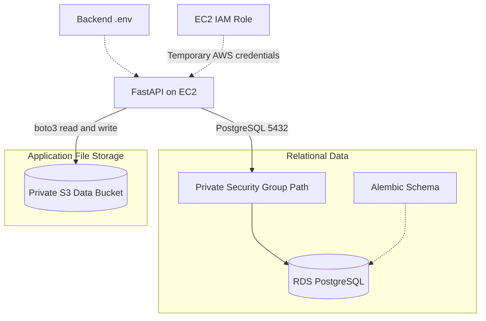
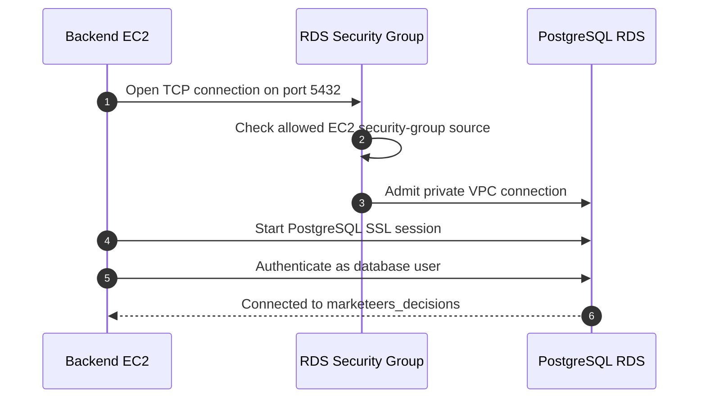
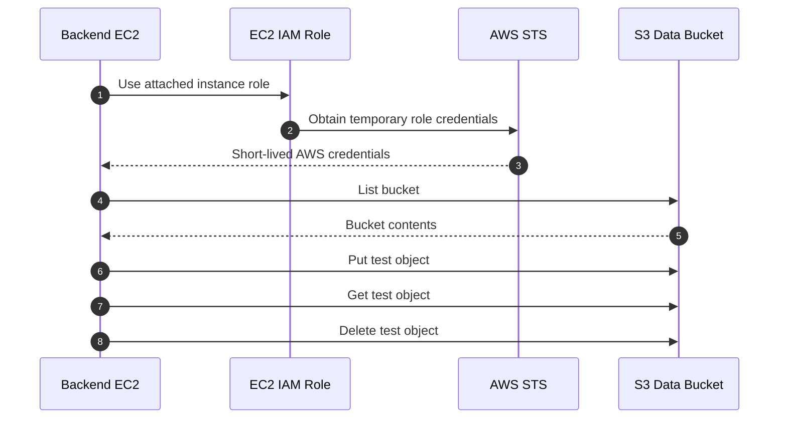
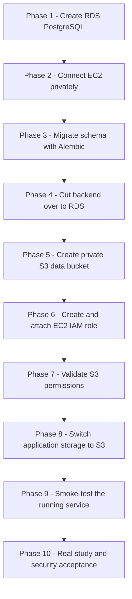
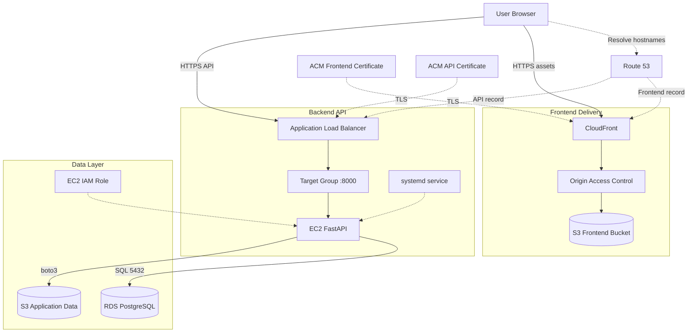

# Marketeers Decisions - AWS Data Layer Deployment

**Architecture reference + step-by-step process SOP**

| Document control | Value |
| --- | --- |
| Version | 1.0 |
| Deployment record | 7 October 2026 |
| Audience | Developers and team members repeating, operating, or maintaining the deployment |
| Database | Amazon RDS for PostgreSQL |
| Application file storage | Private Amazon S3 bucket |
| Backend runtime | FastAPI / Uvicorn on EC2 |
| AWS Region | Europe (Paris), `eu-west-3` |
| Database name | `marketeers_decisions` |
| RDS identifier | `marketeers-decisions-db` |
| Application-data bucket | `marketeers-decisions-data` |
| Scope | RDS provisioning, schema migration, EC2-to-RDS connectivity, S3 application storage, IAM access, backend configuration, and validation |
| Companion documents | [Frontend Deployment](Marketeers_Decisions_Frontend_Architecture_and_Process.md) and [Backend Deployment](Marketeers_Decisions_Backend_Architecture_and_Process.md) |

> **Current status:** PostgreSQL RDS was provisioned, connected privately to the existing EC2 backend, migrated with Alembic, and used successfully by the running FastAPI service. The application-data S3 bucket and EC2 IAM role were created, IAM access was validated with `boto3`, and the backend restarted successfully in `MARKET_SIM_STORAGE=s3` mode.
>
> **Remaining acceptance test:** A real application study has not yet been uploaded after switching storage mode to S3. Therefore, EC2 IAM access to the bucket is verified, but the complete application workflow that parses a Design Excel/HBU pair, persists application files in S3, and records corresponding metadata in RDS is still pending.
>
> **Security release gate:** `MARKET_SIM_AUTH=dev` is still configured. Production authentication and tenant/resource authorization remain separate requirements. The database password shown during deployment should be rotated before production use, and no password is reproduced in this document.

## Contents

- [Part I - Architecture and data-layer reference](#part-i)
- [Part II - Step-by-step deployment process](#part-ii)
  - [Phases 1-2: RDS creation and private EC2 connectivity](#phase-1)
  - [Phases 3-4: PostgreSQL connection, Alembic migration, and backend cutover](#phase-3)
  - [Phases 5-7: S3 bucket, IAM role, and access validation](#phase-5)
  - [Phases 8-9: S3 application mode and smoke testing](#phase-8)
  - [Phase 10: Remaining acceptance and security closeout](#phase-10)
- [Appendix A - Troubleshooting](#appendix-a)
- [Appendix B - Recorded resource inventory](#appendix-b)
- [Appendix C - Handover and acceptance checklist](#appendix-c)
- [Appendix D - Integrated frontend + backend + data architecture](#appendix-d)

**Diagram format:** Diagrams are editable Mermaid code blocks and intentionally use conservative syntax for compatibility with Markdown renderers. The large architecture diagrams use short labels and vertical grouping so the text stays readable in ordinary Markdown preview windows.

<a id="part-i"></a>
# Part I - Architecture and data-layer reference

## 1. Purpose and use cases

This document records the data-layer phase implemented after the frontend and backend deployment. It explains what was built, why each service exists, how the backend connects to it, and how to repeat the process safely.

| Use case | How to use this document |
| --- | --- |
| Repeat the Marketeers Decisions data-layer deployment | Follow Part II using the application's actual resource names and current AWS account. |
| Replace local SQLite with managed PostgreSQL | Follow the RDS, connectivity, `DATABASE_URL`, and Alembic phases. |
| Replace local application file storage with S3 | Follow the S3, IAM, environment, and validation phases. |
| Diagnose database or storage failures | Use Appendix A and test the layers independently: EC2 network, credentials, schema, IAM identity, bucket permissions, and application behavior. |
| Prepare for customer use | Complete the pending real-study, persistence, backup/recovery, authentication, and authorization tests. |

### Responsibility split

| Component | Responsibility in this deployment |
| --- | --- |
| Amazon RDS PostgreSQL | Durable relational store for application/catalog records such as clients, studies, and optimizer jobs. |
| Alembic | Creates and versions the relational schema. |
| EC2 backend | Runs FastAPI and initiates PostgreSQL and S3 operations. |
| RDS/EC2 security groups | Permit private PostgreSQL traffic between the backend EC2 instance and RDS. |
| Amazon S3 application-data bucket | Durable object storage for application files such as study data, uploads, scenarios, and exports as supported by the application. |
| EC2 IAM role | Supplies temporary AWS credentials to the backend without embedding long-lived access keys. |
| `boto3` | AWS SDK used by the backend and by deployment tests to access S3. |
| `.env` | Selects PostgreSQL and S3 runtime configuration for the FastAPI service. |
| systemd | Restarts the backend after configuration changes and supplies the `.env` file to Uvicorn. |

## 2. Data-layer architecture overview



**Design intent:** Relational metadata and job/catalog records live in PostgreSQL, while application files are stored in S3. The EC2 filesystem should be treated as application/runtime storage rather than the primary durable data store.

## 3. Amazon RDS PostgreSQL configuration

| Setting | Recorded value |
| --- | --- |
| DB identifier | `marketeers-decisions-db` |
| Engine | PostgreSQL |
| Recorded server version | `18.3` |
| Engine selection shown during creation | PostgreSQL `18.3-R2` |
| DB instance class | `db.t4g.micro` |
| Deployment | Single-AZ |
| Availability Zone | `eu-west-3a` |
| Initial database | `marketeers_decisions` |
| Master username | `postgres` |
| Authentication | Password authentication |
| Credential management | Self-managed during this deployment |
| Storage | 20 GiB General Purpose SSD (`gp2` in the selected Free Tier configuration) |
| Public access | No |
| Encryption | Enabled with default `aws/rds` KMS key |
| Automated backup | Enabled |
| Backup retention | 1 day in the recorded setup |
| RDS Proxy | Not enabled |
| Database Insights | Standard, 7-day retention shown as free |
| Enhanced Monitoring | Not enabled |
| DevOps Guru | Not enabled |

The console displayed account-specific RDS Free Tier eligibility for 12 months, including 750 hours per month for a qualifying Single-AZ micro instance, 20 GB of General Purpose SSD storage, and 20 GB of automated backup/snapshot storage. This is an account-specific commercial allowance observed during the deployment and should be rechecked before repeating it.

## 4. EC2-to-RDS connectivity model

The RDS creation workflow used **Connect to an EC2 compute resource** and selected the existing backend instance. AWS then configured the database in the same VPC and created the associated connectivity security groups.

| Item | Recorded value |
| --- | --- |
| Backend EC2 | `Marketeers-Decisions-Backend` |
| EC2 instance ID | `i-004e1b6acea883ff3` |
| VPC | `vpc-b5fa0bdd` |
| DB subnet group | Automatic setup during EC2 connection |
| RDS public access | Disabled |
| PostgreSQL port | `5432` |
| RDS-side connectivity group shown | `rds-ec2-1` |
| RDS security group ID shown | `sg-075308bdeb2a61092` |

The database endpoint used during the walkthrough was:

```text
marketeers-decisions-db.cji28kcaycas.eu-west-3.rds.amazonaws.com
```

The endpoint is not a password or secret, but this document keeps infrastructure identifiers for internal handover rather than customer-facing publication.



The successful `psql` session reported TLS 1.3. RDS was therefore reachable privately from the EC2 backend without making the database publicly accessible.

## 5. Database schema and Alembic migration

The backend already contained an Alembic migration head:

```text
0001_initial
```

The migration created the initial catalog schema in PostgreSQL. The confirmed tables were:

| Table | Recorded purpose / role |
| --- | --- |
| `alembic_version` | Tracks the applied Alembic revision. |
| `clients` | Application client/catalog records. |
| `studies` | Study catalog/metadata records. |
| `optimizer_jobs` | Optimizer job records. |

The migration sequence used:

```bash
alembic heads
alembic current
alembic upgrade head
alembic current
```

After the upgrade, `alembic current` reported:

```text
0001_initial (head)
```

A direct PostgreSQL `\dt` confirmed all four tables.

## 6. Backend database configuration

The earlier temporary configuration used SQLite:

```dotenv
DATABASE_URL=sqlite:///./data/app.db
```

The deployment changed it to a PostgreSQL SQLAlchemy/psycopg URL with the RDS endpoint and the `marketeers_decisions` database.

**Safe pattern only:**

```dotenv
DATABASE_URL=postgresql+psycopg://postgres:<PASSWORD>@marketeers-decisions-db.cji28kcaycas.eu-west-3.rds.amazonaws.com:5432/marketeers_decisions
```

Do not store the real password in documentation, screenshots, source control, or chat. The password used during deployment became visible in a screenshot and should therefore be rotated before production use.

## 7. Amazon S3 application-data bucket

A dedicated bucket was created for application data. This is separate from the frontend S3 bucket.

| Setting | Recorded value |
| --- | --- |
| Bucket name | `marketeers-decisions-data` |
| Region | Europe (Paris), `eu-west-3` |
| Bucket type | General purpose |
| Namespace | Global namespace |
| Object ownership | ACLs disabled / Bucket owner enforced |
| Block Public Access | All public access blocked |
| Versioning | Disabled in the initial setup |
| Default encryption | SSE-S3 |
| Static website hosting | Not used |

Potential application prefixes include `studies/`, `uploads/`, `scenarios/`, and `exports/`. S3 prefixes are logical key prefixes rather than physical folders; the application may create them automatically when it writes objects.

## 8. EC2 IAM role and least-privilege S3 access

A dedicated EC2 role was created:

```text
MarketeersDecisionsS3DataAccess
```

Trusted entity:

```text
AWS Service: EC2
```

It was attached to backend instance:

```text
i-004e1b6acea883ff3
```

The inline policy used during the walkthrough restricts access to the single application-data bucket:

```json
{
  "Version": "2012-10-17",
  "Statement": [
    {
      "Sid": "ListMarketeersDecisionsBucket",
      "Effect": "Allow",
      "Action": [
        "s3:ListBucket"
      ],
      "Resource": "arn:aws:s3:::marketeers-decisions-data"
    },
    {
      "Sid": "ReadWriteMarketeersDecisionsObjects",
      "Effect": "Allow",
      "Action": [
        "s3:GetObject",
        "s3:PutObject",
        "s3:DeleteObject"
      ],
      "Resource": "arn:aws:s3:::marketeers-decisions-data/*"
    }
  ]
}
```

This avoids putting an AWS access key and secret key in `.env`.



The `boto3` STS test returned an assumed-role identity for `MarketeersDecisionsS3DataAccess`. List, upload, read, and delete operations all completed successfully.

## 9. Backend storage configuration

The backend was switched from local application storage to S3 mode.

Recorded safe configuration pattern:

```dotenv
APP_ENV=production

MARKET_SIM_STORAGE=s3
MARKET_SIM_S3_BUCKET=marketeers-decisions-data
AWS_REGION=eu-west-3

MARKET_SIM_AUTH=dev
MARKET_SIM_DEV_CLIENT_ID=local-dev

DATABASE_URL=postgresql+psycopg://postgres:<PASSWORD>@marketeers-decisions-db.cji28kcaycas.eu-west-3.rds.amazonaws.com:5432/marketeers_decisions

MARKET_SIM_DECIMALS=2
```

After editing `.env`, the service was reloaded/restarted through systemd. Logs showed the PostgreSQL Alembic implementation during startup, and the local API continued to respond successfully.

## 10. Verification record

| Check | Observed result | What it proves |
| --- | --- | --- |
| RDS state | `Available` | The database instance finished provisioning. |
| EC2-to-RDS DNS | Endpoint resolved to a private VPC address | The backend resolved the RDS endpoint internally. |
| PostgreSQL login | Successful with `psql` | Network, user/password, and database name were valid. |
| PostgreSQL transport | TLS 1.3 reported | The successful direct test used an encrypted PostgreSQL session. |
| Alembic | `0001_initial (head)` | Initial schema migration applied to RDS. |
| PostgreSQL tables | Four tables visible with `\dt` | Expected initial catalog tables exist. |
| FastAPI restart | `marketeers-decisions.service` active | Backend restarted with new database configuration. |
| Local API | `GET /api/studies` returned HTTP 200 and `[]` | FastAPI could operate against the new empty PostgreSQL catalog. |
| Frontend Data Hub | Displayed `No studies yet` | Browser-to-API-to-database read path worked end-to-end. |
| IAM identity | `assumed-role/MarketeersDecisionsS3DataAccess/...` | EC2 received credentials from the attached IAM role. |
| S3 list | Returned empty contents on the new bucket | EC2 role had bucket-list access. |
| S3 object operations | Upload, read, and delete all succeeded | EC2 role had the required object permissions. |
| Backend in S3 mode | Service restarted and `/api/studies` remained HTTP 200 | Backend starts successfully with S3 configuration enabled. |

**Still pending:** A real study upload has not yet demonstrated that the application's own storage abstraction writes the expected files/prefixes to S3 and persists matching metadata to RDS.

## 11. Current security and operational boundaries

| Item | Status / requirement |
| --- | --- |
| RDS public exposure | Disabled. Keep the database private. |
| S3 public exposure | Blocked. Keep the data bucket private. |
| AWS credentials in application files | Not required; EC2 IAM role is used. |
| Database password | Rotate after the deployment screenshot exposure. |
| `MARKET_SIM_AUTH` | Still `dev`; not a production authentication solution. |
| Tenant/resource authorization | Not yet accepted. |
| Real study upload | Pending. |
| Scenario/export/optimizer persistence | Pending end-to-end verification in S3 mode. |
| Backup/restore | Features exist, but restore behavior has not yet been accepted through testing. |
| S3 versioning | Disabled in the initial setup; review before storing production customer data. |
| RDS deletion protection | Recommended; final state was not independently reverified in the captured post-creation screens. |

<a id="part-ii"></a>
# Part II - Step-by-step deployment process

## How to execute this SOP

| Label | Where to perform the action |
| --- | --- |
| **AWS Console** | Browser signed in to the correct AWS account and Region. |
| **EC2 - SSH** | Ubuntu shell on `Marketeers-Decisions-Backend`. |
| **Browser test** | Production site or API in a normal browser. |
| **PostgreSQL shell** | Interactive `psql` session opened from EC2. |

Do not paste real passwords into documentation or screenshots. Use placeholders in handover material and approved secret-storage procedures in operation.



<a id="phase-1"></a>
## Phase 1 - Create PostgreSQL RDS

### Step 1 - Open the RDS creation workflow

**Where: AWS Console**

1. Select **Europe (Paris), eu-west-3**.
2. Open **RDS > Databases > Create database**.
3. Choose **Full configuration**.
4. Select **PostgreSQL**, not Aurora PostgreSQL.
5. Select the **Free Tier** template if the account shows it as eligible.

### Step 2 - Configure the database engine and identity

**Where: AWS Console - Create database**

Use the recorded values:

```text
Engine: PostgreSQL
Engine version selected: PostgreSQL 18.3-R2
DB instance identifier: marketeers-decisions-db
Master username: postgres
Credentials management: Self managed
Authentication: Password authentication
RDS Extended Support: Off
```

Create a strong password and store it securely. Do not place it in screenshots or Git.

### Step 3 - Choose low-cost initial capacity

```text
Deployment: Single-AZ DB instance
Instance class: Burstable
Instance type: db.t4g.micro
Storage: General Purpose SSD
Allocated storage: 20 GiB
```

The account creation screen showed these values inside its RDS Free Tier allowance. Recheck the current account before assuming future deployments are free.

## Phase 2 - Configure private EC2 connectivity

### Step 4 - Connect RDS to the existing backend EC2 resource

**Where: AWS Console - Connectivity**

Choose:

```text
Compute resource: Connect to an EC2 compute resource
EC2 instance: Marketeers-Decisions-Backend
VPC: Default VPC / vpc-b5fa0bdd
DB subnet group: Automatic setup
Public access: No
RDS Proxy: Off
Availability Zone: eu-west-3a in the resulting deployment
```

AWS created the required connectivity security-group relationship automatically.

### Step 5 - Configure monitoring and database options

Recorded settings:

```text
Database Insights: Standard
Detailed metrics retention: 7 days
Enhanced Monitoring: Off
DevOps Guru: Off
Encryption: Enabled
KMS key: default aws/rds
Automated backup: Enabled
Backup retention: 1 day
Auto minor version upgrade: Enabled
Backup replication to another Region: Off
```

Set the initial database name:

```text
marketeers_decisions
```

Create the database and wait until status becomes **Available**.

<a id="phase-3"></a>
## Phase 3 - Test PostgreSQL and migrate the schema

### Step 6 - Install a PostgreSQL client on EC2

**Where: EC2 - SSH**

```bash
cd ~/Marketeers-Decisions/backend
source .venv/bin/activate
sudo apt update
sudo apt install -y postgresql-client
```

Ubuntu 24.04 installed the PostgreSQL 16 client during the walkthrough. A client/server major-version warning appeared when connecting to PostgreSQL 18.3; the basic connectivity and SQL checks used here still succeeded.

### Step 7 - Test the RDS connection

**Where: EC2 - SSH**

```bash
psql \
  -h marketeers-decisions-db.cji28kcaycas.eu-west-3.rds.amazonaws.com \
  -p 5432 \
  -U postgres \
  -d marketeers_decisions
```

Enter the database password when prompted.

Inside `psql`:

```sql
SELECT version();
```

Expected outcome from the recorded deployment:

```text
PostgreSQL 18.3 ...
SSL connection ... TLSv1.3 ...
```

Exit:

```text
\q
```

### Step 8 - Update the backend database URL

**Where: EC2 - SSH**

```bash
cd ~/Marketeers-Decisions/backend
nano .env
```

Replace the SQLite URL with a PostgreSQL URL using the actual password:

```dotenv
DATABASE_URL=postgresql+psycopg://postgres:<PASSWORD>@marketeers-decisions-db.cji28kcaycas.eu-west-3.rds.amazonaws.com:5432/marketeers_decisions
```

If the password contains URI-reserved characters, URL-encode them correctly before putting them into a URI. Never expose the resulting value in screenshots.

### Step 9 - Apply Alembic migrations

**Where: EC2 - SSH**

```bash
cd ~/Marketeers-Decisions/backend
source .venv/bin/activate
alembic heads
alembic current
alembic upgrade head
alembic current
```

Recorded result:

```text
0001_initial (head)
```

### Step 10 - Confirm the database tables

```bash
psql \
  -h marketeers-decisions-db.cji28kcaycas.eu-west-3.rds.amazonaws.com \
  -p 5432 \
  -U postgres \
  -d marketeers_decisions
```

Inside `psql`:

```text
\dt
```

Expected tables:

```text
alembic_version
clients
optimizer_jobs
studies
```

Then exit:

```text
\q
```

## Phase 4 - Cut the running backend over to PostgreSQL

### Step 11 - Reload systemd and restart FastAPI

**Where: EC2 - SSH**

```bash
sudo systemctl daemon-reload
sudo systemctl restart marketeers-decisions
sudo systemctl status marketeers-decisions --no-pager
```

If a warning says the unit file changed on disk, `daemon-reload` is required before relying on the latest unit definition.

### Step 12 - Test the local studies endpoint

```bash
curl -i http://127.0.0.1:8000/api/studies
```

Recorded result:

```text
HTTP/1.1 200 OK
[]
```

### Step 13 - Confirm the browser integration

**Where: Browser test**

Open:

```text
https://decisions.marketeers-ba.com/data-hub
```

Recorded result:

```text
No studies yet. Use the upload section below to create one.
```

This confirms the read path from browser to frontend, API, EC2, and RDS for the empty catalog.

<a id="phase-5"></a>
## Phase 5 - Create the S3 application-data bucket

### Step 14 - Create a dedicated private bucket

**Where: AWS Console > S3 > Create bucket**

Use:

```text
Region: Europe (Paris) / eu-west-3
Bucket type: General purpose
Bucket name: marketeers-decisions-data
Object Ownership: ACLs disabled / Bucket owner enforced
Block all public access: Enabled
Bucket versioning: Disabled in the initial setup
Default encryption: SSE-S3
```

Do not use the frontend bucket for application study data.

### Step 15 - Leave prefixes to the application

Do not manually create folders merely to make the bucket look organized. When the application writes keys such as `studies/...` or `exports/...`, S3 will present those prefixes as folders in the console.

## Phase 6 - Create the EC2 IAM role

### Step 16 - Create a role trusted by EC2

**Where: AWS Console > IAM > Roles > Create role**

```text
Trusted entity type: AWS service
Use case: EC2
Role name: MarketeersDecisionsS3DataAccess
```

### Step 17 - Add the bucket-specific inline policy

Use the policy shown in Part I, Section 8. It grants only:

```text
s3:ListBucket
s3:GetObject
s3:PutObject
s3:DeleteObject
```

and only against:

```text
arn:aws:s3:::marketeers-decisions-data
arn:aws:s3:::marketeers-decisions-data/*
```

Do not attach `AdministratorAccess` or broad `AmazonS3FullAccess` merely to make the test pass.

### Step 18 - Attach the role to the backend EC2 instance

**Where: AWS Console > EC2 > Instances > Marketeers-Decisions-Backend**

Choose:

```text
Actions > Security > Modify IAM role
```

Select:

```text
MarketeersDecisionsS3DataAccess
```

Update the role association.

<a id="phase-7"></a>
## Phase 7 - Validate IAM and S3 access

The AWS CLI package was not available through the attempted Ubuntu `apt` install in this walkthrough, so the existing Python environment and `boto3` were used instead.

### Step 19 - Confirm the attached IAM identity

**Where: EC2 - SSH, backend virtual environment**

```bash
python - <<'PY'
import boto3
print(boto3.client("sts").get_caller_identity())
PY
```

Expected ARN pattern:

```text
arn:aws:sts::<ACCOUNT>:assumed-role/MarketeersDecisionsS3DataAccess/<INSTANCE-SESSION>
```

### Step 20 - Confirm bucket listing

```bash
python - <<'PY'
import boto3
s3 = boto3.client("s3", region_name="eu-west-3")
resp = s3.list_objects_v2(Bucket="marketeers-decisions-data")
print(resp.get("Contents", []))
PY
```

The new bucket returned an empty list during the walkthrough.

### Step 21 - Validate write, read, and delete

```bash
python - <<'PY'
import boto3

s3 = boto3.client("s3", region_name="eu-west-3")
bucket = "marketeers-decisions-data"
key = "test/iam-test.txt"

s3.put_object(Bucket=bucket, Key=key, Body=b"s3 test")
print("UPLOAD OK")

obj = s3.get_object(Bucket=bucket, Key=key)
print("READ OK:", obj["Body"].read().decode())

s3.delete_object(Bucket=bucket, Key=key)
print("DELETE OK")
PY
```

Recorded result:

```text
UPLOAD OK
READ OK: s3 test
DELETE OK
```

<a id="phase-8"></a>
## Phase 8 - Switch the application from local storage to S3

### Step 22 - Update `.env`

**Where: EC2 - SSH**

```bash
cd ~/Marketeers-Decisions/backend
nano .env
```

Use:

```dotenv
MARKET_SIM_STORAGE=s3
MARKET_SIM_S3_BUCKET=marketeers-decisions-data
AWS_REGION=eu-west-3
```

Retain the PostgreSQL database URL and the other existing application settings.

Do not add AWS access-key variables. The backend should obtain credentials from the EC2 IAM role.

### Step 23 - Reload and restart the backend

```bash
sudo systemctl daemon-reload
sudo systemctl restart marketeers-decisions
sudo systemctl status marketeers-decisions --no-pager
sudo journalctl -u marketeers-decisions -n 80 --no-pager
```

Recorded logs showed the PostgreSQL Alembic implementation and a successful service start.

<a id="phase-9"></a>
## Phase 9 - Smoke-test the running S3-mode backend

### Step 24 - Recheck the local API

```bash
curl -i http://127.0.0.1:8000/api/studies
```

Recorded result after the storage-mode change:

```text
HTTP/1.1 200 OK
[]
```

This proves that the application still starts and can read its PostgreSQL catalog while configured for S3 storage. It does not prove the complete application S3 write path.

<a id="phase-10"></a>
## Phase 10 - Remaining acceptance and security closeout

### Step 25 - Rotate the database password

The database password became visible during the deployment walkthrough. Before production use:

1. Open **RDS > marketeers-decisions-db > Modify**.
2. Set a new strong master password.
3. Apply the change according to the approved maintenance policy.
4. Update only the password portion of `DATABASE_URL` in the EC2 `.env`.
5. Restart the backend.
6. Confirm `/api/studies` returns successfully.

Do not place the replacement password in screenshots, tickets, Git, or documentation.

### Step 26 - Perform the real application storage test

Use approved non-sensitive test inputs in **Data Hub & Trust**:

1. Upload a valid Design Excel workbook.
2. Upload the matching HBU file.
3. Complete parse/review/create.
4. Confirm the new study appears in the UI.
5. Confirm the corresponding catalog row exists in PostgreSQL.
6. Confirm expected application objects appear under `marketeers-decisions-data`.
7. Open/reload the study and verify it still works.
8. Save/reload a scenario where supported.
9. Test export behavior where supported.
10. Restart the backend and confirm durable state survives.

### Step 27 - Complete the production authorization gate

Replace and test development authentication before external customer use. Infrastructure controls such as private RDS, private S3, IAM, HTTPS, and CORS do not implement user authentication or tenant isolation by themselves.

<a id="appendix-a"></a>
# Appendix A - Troubleshooting

| Symptom | Likely interpretation | Next action |
| --- | --- | --- |
| `password authentication failed for user postgres` | Password is incorrect or does not match the current RDS master password. | Re-enter carefully; if necessary rotate the RDS password and update `DATABASE_URL`. |
| `no pg_hba.conf entry ... no encryption` appears after a failed login | The client attempted a fallback connection mode after the first failure. | Correct the credentials and use the successful SSL connection; do not edit RDS `pg_hba.conf` directly. |
| RDS endpoint times out from EC2 | Connectivity SG, VPC, subnet, or endpoint configuration is wrong. | Check the connected compute resource, RDS security groups, VPC, and port `5432`. |
| `alembic current` is empty on a new RDS | No revision has been applied yet. | Run `alembic upgrade head`, then recheck. |
| `alembic upgrade head` fails | Schema/configuration/dependency problem. | Read the exact traceback; do not restart the production service until the migration issue is understood. |
| `\dt` shows no application tables | Migration did not apply to the intended database. | Confirm `DATABASE_URL`, current database, and Alembic revision. |
| Service is active but API fails after DB cutover | Startup snapshot may be misleading or runtime DB access is failing. | Inspect `journalctl`, then test `/api/studies` locally. |
| `aws: command not found` | AWS CLI is not installed. | Use the existing `boto3` tests or install AWS CLI through an approved supported method. |
| STS ARN does not show the expected role | EC2 IAM role is missing or wrong. | Check **Modify IAM role** on the intended instance. |
| S3 `AccessDenied` on ListBucket | Role lacks bucket-level `s3:ListBucket`. | Check the bucket ARN statement. |
| S3 `AccessDenied` on Get/Put/Delete | Role lacks object permissions or the object ARN is wrong. | Check `arn:aws:s3:::marketeers-decisions-data/*` and the required actions. |
| `boto3` test succeeds but application upload fails | IAM is working; application storage implementation or input processing may be failing. | Inspect application logs and the code's S3 storage path; verify object keys and expected prefixes. |
| `/api/studies` returns `[]` | The new PostgreSQL catalog is empty. | This is normal until a study is created. |
| Data Hub shows `No studies yet` | Frontend/API/RDS read path is working with an empty catalog. | Perform the approved real-study test. |
| systemd warns that unit files changed on disk | systemd has not reloaded the latest unit definition. | Run `sudo systemctl daemon-reload` before restart. |

Useful commands:

```bash
sudo systemctl status marketeers-decisions --no-pager
sudo journalctl -u marketeers-decisions -n 100 --no-pager
curl -i http://127.0.0.1:8000/api/studies
```

PostgreSQL schema check:

```bash
alembic current
```

S3 role identity check:

```bash
python - <<'PY'
import boto3
print(boto3.client("sts").get_caller_identity())
PY
```

<a id="appendix-b"></a>
# Appendix B - Recorded resource inventory

These values identify resources observed during the deployment. Generated IDs and endpoints may differ in another environment.

| Resource | Recorded identifier / value |
| --- | --- |
| AWS Region | `eu-west-3` |
| VPC | `vpc-b5fa0bdd` |
| Backend EC2 name | `Marketeers-Decisions-Backend` |
| Backend EC2 ID | `i-004e1b6acea883ff3` |
| Backend private IP | `172.31.5.7` |
| RDS identifier | `marketeers-decisions-db` |
| RDS engine | PostgreSQL 18.3 |
| RDS class | `db.t4g.micro` |
| RDS AZ | `eu-west-3a` |
| RDS database | `marketeers_decisions` |
| RDS port | `5432` |
| RDS endpoint | `marketeers-decisions-db.cji28kcaycas.eu-west-3.rds.amazonaws.com` |
| RDS public access | No |
| RDS-side connectivity SG | `rds-ec2-1` |
| RDS-side SG ID shown | `sg-075308bdeb2a61092` |
| Alembic head | `0001_initial` |
| Catalog tables | `alembic_version`, `clients`, `optimizer_jobs`, `studies` |
| S3 application-data bucket | `marketeers-decisions-data` |
| S3 public access | Blocked |
| S3 encryption | SSE-S3 |
| IAM role | `MarketeersDecisionsS3DataAccess` |
| Storage mode | `MARKET_SIM_STORAGE=s3` |
| AWS Region variable | `AWS_REGION=eu-west-3` |
| Application auth mode | `MARKET_SIM_AUTH=dev` |

Do not add real passwords, access keys, private keys, or tokens to this inventory.

<a id="appendix-c"></a>
# Appendix C - Handover and acceptance checklist

## C1. Observed as completed

- [x] PostgreSQL RDS instance created.
- [x] RDS configured without public access.
- [x] RDS connected to the existing backend EC2 resource.
- [x] PostgreSQL client connection succeeded over SSL.
- [x] Backend `DATABASE_URL` changed from SQLite to PostgreSQL.
- [x] Alembic `0001_initial` migration applied.
- [x] `alembic_version`, `clients`, `optimizer_jobs`, and `studies` confirmed in RDS.
- [x] FastAPI service restarted successfully on PostgreSQL.
- [x] Local `/api/studies` returned HTTP 200 and an empty list.
- [x] Production Data Hub displayed `No studies yet`.
- [x] Private S3 application-data bucket created.
- [x] EC2 IAM role created and attached.
- [x] IAM role identity confirmed through STS.
- [x] S3 list operation succeeded.
- [x] S3 upload/read/delete test succeeded through `boto3`.
- [x] Backend configuration switched to `MARKET_SIM_STORAGE=s3`.
- [x] Backend restarted successfully in S3 storage mode.
- [x] `/api/studies` remained healthy after the storage-mode change.

## C2. Still to complete before production acceptance

- [ ] Rotate the RDS database password exposed during the setup walkthrough.
- [ ] Perform a valid Design Excel + HBU upload after switching to S3 mode.
- [ ] Confirm application-created S3 keys/prefixes and their reload behavior.
- [ ] Confirm the corresponding study record is stored in RDS.
- [ ] Test simulation, optimization, PPA, assortment, scenarios, and exports with a real study.
- [ ] Test persistence after backend restart/reboot.
- [ ] Define and test RDS backup/restore procedures.
- [ ] Review S3 versioning/lifecycle requirements for production data.
- [ ] Confirm final RDS deletion-protection policy.
- [ ] Implement and verify production authentication.
- [ ] Verify tenant/resource ownership and cross-tenant isolation.

## C3. Handover record

| Item | Owner / evidence to record |
| --- | --- |
| Deployment owner and reviewer | To be recorded |
| Approved backend commit | To be recorded |
| RDS password rotation | Completion evidence only; never store password |
| RDS database identifier and endpoint | Confirm current values |
| Alembic head | Record current production revision |
| Application-data bucket | Confirm bucket and Region |
| IAM role | Confirm attached role and inline policy |
| Real-study acceptance dataset | Approved non-sensitive dataset |
| S3 application-write evidence | Object prefixes/keys created by app |
| RDS application-write evidence | Study/catalog rows created by app |
| Recovery test | RDS/S3/backend restart outcome |
| Authentication release decision | Required before customer data |

<a id="appendix-d"></a>
# Appendix D - Integrated frontend + backend + data architecture

The diagram below combines the three companion topics in one readable flow: **Frontend delivery**, **Backend API**, and **Database / application storage**.



### End-to-end interpretation

1. The browser resolves the frontend and API hostnames through Route 53.
2. CloudFront serves the React/Vite build from the private frontend S3 bucket through OAC.
3. The React application calls the API hostname over HTTPS.
4. The ALB terminates API HTTPS and forwards requests to the EC2 FastAPI target on port `8000`.
5. FastAPI uses PostgreSQL RDS for relational catalog/application records.
6. FastAPI uses its EC2 IAM role to read and write application files in the private data S3 bucket.
7. The frontend bucket and the application-data bucket are separate and serve different purposes.
8. RDS and the application-data S3 bucket are not public application endpoints.

### Current acceptance boundary

```text
Frontend delivery              VERIFIED
Backend API connectivity       VERIFIED
RDS PostgreSQL cutover         VERIFIED
EC2 IAM -> S3 permissions      VERIFIED
Backend starts in S3 mode      VERIFIED
Real study -> S3 + RDS roundtrip  PENDING
Production authentication        PENDING
```

---

**Documentation boundary:** This document records the deployment demonstrated on 7 October 2026. It distinguishes completed infrastructure and smoke tests from the real-study, persistence, recovery, and production-authentication checks that remain outstanding.
