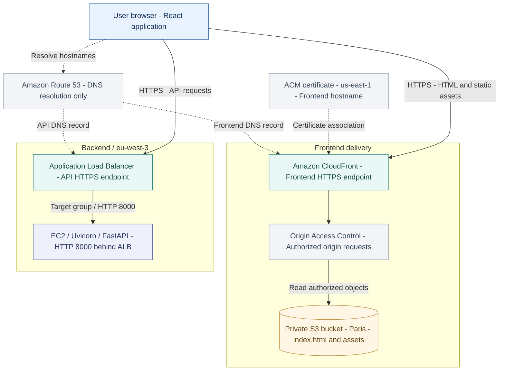
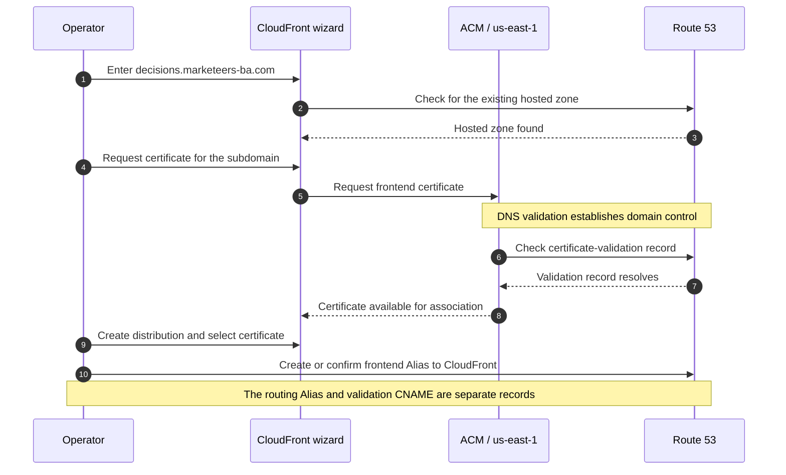
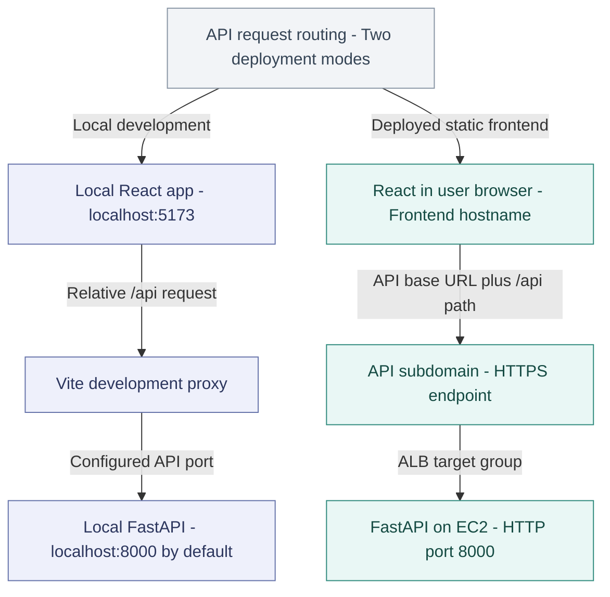
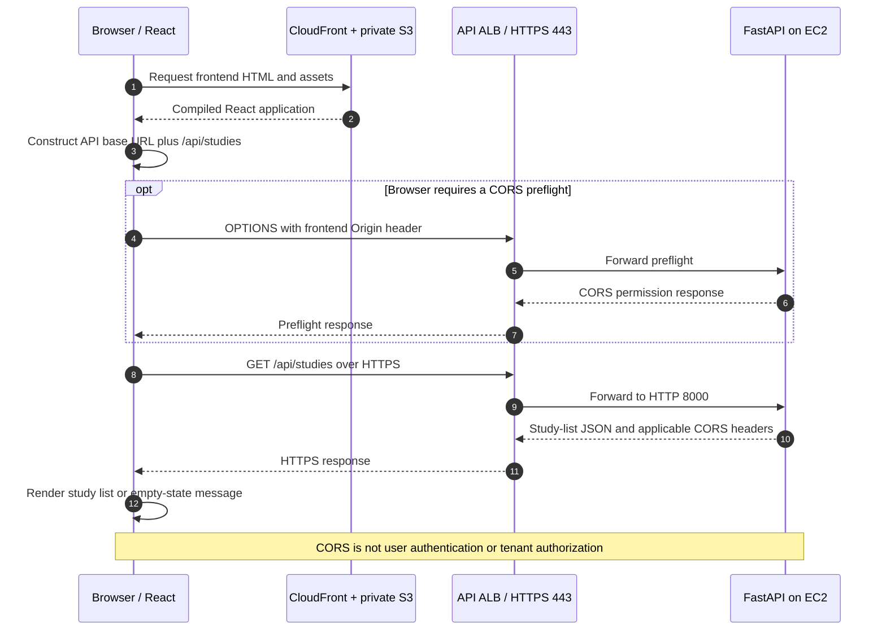
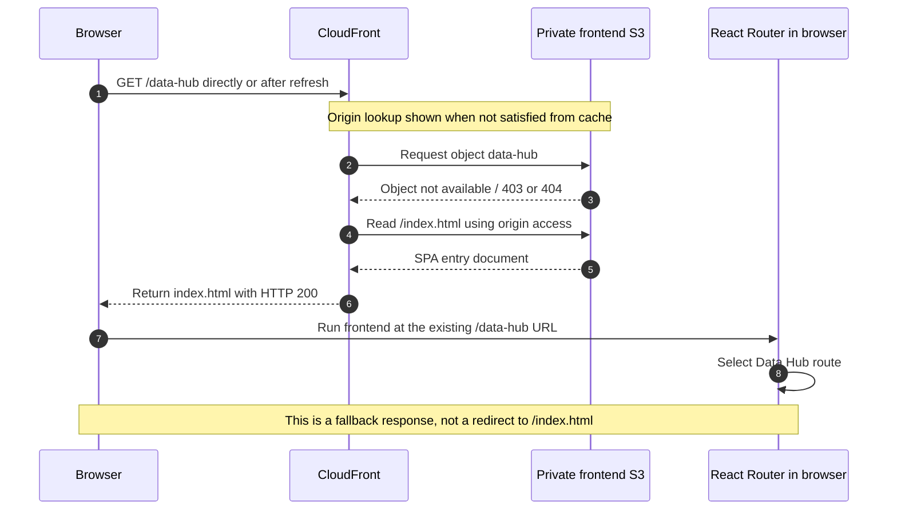
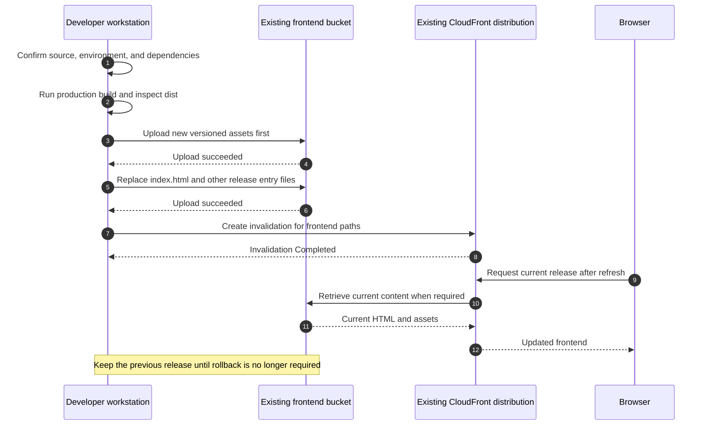
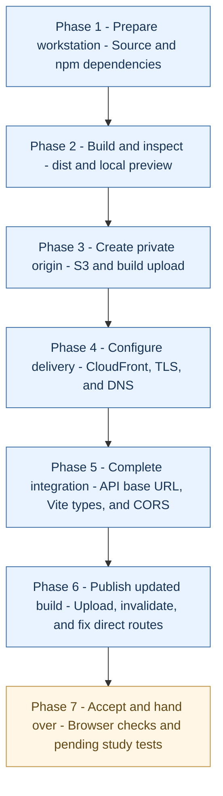

# Marketeers Decisions - AWS Frontend Deployment

**Architecture reference + step-by-step process SOP**

| Document control | Value |
| --- | --- |
| Version | 1.0 |
| Deployment record | 5-7 October 2026 |
| Audience | Developers and team members repeating or maintaining the deployment |
| Frontend | React / TypeScript / Vite |
| Hosting | Private Amazon S3 origin behind Amazon CloudFront |
| S3 Region | Europe (Paris), `eu-west-3` |
| CloudFront certificate Region | US East (N. Virginia), `us-east-1` |
| Public frontend | `https://decisions.marketeers-ba.com` |
| API used by the frontend | `https://api-decisions.marketeers-ba.com` |
| Scope | Frontend build, S3, CloudFront, HTTPS, DNS, SPA routing, and API integration |
| Companion document | [Backend Architecture and Process](Marketeers_Decisions_Backend_Architecture_and_Process.md) |

> **Current status:** The frontend loaded over HTTPS, the direct `/data-hub` route displayed after the routing correction, and the earlier study-loading error was replaced by `No studies yet`. These are the observed hosting/integration outcomes, not proof that study import, simulation, optimization, or all other screens have passed functional testing.
>
> **External-release gate:** The backend configuration recorded during this deployment still uses `MARKET_SIM_AUTH=dev`. A private S3 bucket, CloudFront security features, HTTPS, and CORS do not implement customer login or tenant authorization. Use approved non-sensitive test data until those controls and the remaining acceptance tests are complete.

## Contents

- [Part I - Architecture and deployment reference](#part-i)
- [Part II - Step-by-step deployment process](#part-ii)
  - [Phases 1-2: Workstation, dependencies, build, and preview](#phase-1)
  - [Phases 3-4: Private S3 and CloudFront creation](#phase-3)
  - [Phase 5: Root document, DNS, and initial frontend test](#phase-5)
  - [Phases 6-7: API base URL, Vite types, and backend CORS](#phase-6)
  - [Phases 8-9: Updated release, invalidation, and SPA routing](#phase-8)
  - [Phases 10-11: Integration tests, repeat releases, and handover](#phase-10)
- [Appendix A - Troubleshooting](#appendix-a)
- [Appendix B - Recorded resource inventory](#appendix-b)
- [Appendix C - Release checklist and next phase](#appendix-c)
- [Appendix D - Evidence and technical references](#appendix-d)

**Diagram format:** Diagrams are editable Mermaid code blocks, using the same visual style as the backend document. Open this file in a Markdown renderer with Mermaid support to display the diagrams rather than their source code.

**Reading the record:** Recorded settings and observed results come from the deployment walkthrough and its documents [S1-S4]. Instructions marked **repeat-deployment safeguard** or **acceptance check** are actions to perform, not claims that those checks already passed. Technical references [R1-R8] explain platform behavior; they do not verify the current AWS account.


# Part I - Architecture and deployment reference

## 1. Purpose and use cases

This document explains the frontend deployment that was implemented and provides the execution sequence another team member can follow. It covers the frontend first, then the integration changes made after the backend became available.

| Use case | How to use this document |
| --- | --- |
| Deploy Marketeers Decisions for the first time | Follow Part II from the beginning, using new resource names where existing ones are already in use. |
| Publish another frontend version | Reuse the existing bucket, distribution, certificate, and DNS record; follow the release procedure in Steps 34-37. |
| Deploy another static React/Vite application | Reuse the pattern, but verify its build script, output directory, public path, routes, and API configuration. |
| Deploy an application requiring server-side rendering | Do not assume uploading static files is sufficient. This SOP documents a static SPA, not a Node.js server or SSR runtime. |
| Investigate a frontend error | Use Appendix A to separate DNS, certificate, origin access, route fallback, build, and API problems. |
| Prepare for customer access | Complete the functional and security gates. A rendered frontend is not a full production acceptance test. |

The original deployment discussion considered serving React and FastAPI together on EC2. The chosen frontend pattern was **S3 + CloudFront**, allowing static frontend delivery to be maintained separately from backend compute. This is a use-case choice, not a rule that EC2-hosted frontends are inherently invalid. [S1]

## 2. Component responsibilities

| Component | Responsibility in this deployment | What it does not do |
| --- | --- | --- |
| Git repository | Holds application source and build configuration. | A commit alone does not publish a new frontend in this manual workflow. |
| Node.js / npm on the workstation | Installs dependencies and runs the build scripts. | Does not need to keep running for the deployed S3 frontend. |
| Vite / TypeScript | Produces the static release under `frontend/dist`. | The development proxy is not an AWS production proxy. |
| Amazon S3 | Stores `index.html`, JavaScript, CSS, and other build assets. | Does not run FastAPI, npm, or application database queries. |
| CloudFront | Delivers the frontend over HTTPS and caches content. | Does not automatically route this deployment's `/api` requests to the ALB. |
| Origin Access Control (OAC) | Allows the distribution to read the private S3 origin. | Does not authenticate the application's end users. |
| ACM | Provides the certificate for the frontend hostname. | Does not create the application or make an API authorization decision. |
| Route 53 | Resolves the frontend subdomain to CloudFront. | Is not an HTTP forwarding server and does not host the frontend files. |
| Browser / React Router | Executes React and selects client-side screens. | Cannot load study-dependent screens correctly without the required application state. |
| FastAPI behind the ALB | Processes API requests on the separate API hostname. | Is not hosted in the frontend bucket. |

The scope and roles above follow the frontend SOP and backend integration record. [S1-S3]

## 3. Architecture overview



**Read the arrows correctly:** Solid arrows show content/application requests; dotted arrows show DNS or configuration associations. OAC is an access-control mechanism used by CloudFront, not another independently hosted server. The browser calls the API subdomain directly after it receives and runs the frontend JavaScript. [S3]

## 4. Recorded frontend configuration

| Setting | Recorded value |
| --- | --- |
| Repository | `MarketeersBA/Marketeers-Decisions` |
| Local frontend directory | `D:\Bullding Apps\Pltaform\Marketeers-Decisions\frontend` |
| Build command | `npm run build` |
| Build script shown in output | `tsc -b && vite build` |
| Vite version shown in the build output | `5.4.21` |
| Output directory | `frontend/dist` |
| S3 bucket | `marketeers-decisions-frontend` |
| Bucket Region | `eu-west-3` |
| CloudFront distribution name | `marketeers-decisions-frontend` |
| CloudFront distribution ID | `E14K89NZ3KAV61` |
| Distribution hostname | `d2zfrt3kh3dp83.cloudfront.net` |
| Custom frontend hostname | `decisions.marketeers-ba.com` |
| Hosted zone | `marketeers-ba.com` |
| Default root object | `index.html` |
| API base URL | `https://api-decisions.marketeers-ba.com` |

These are deployment-record values, not a new live inventory. The actual Windows directory names contain the spellings `Bullding Apps` and `Pltaform`; use those for the recorded workstation. The earlier Word SOP used a normalized example path, so another workstation should always use its real local checkout path. [S2-S4]

## 5. Build files versus application source

The frontend source is not uploaded as an entire repository. The deployed artifact is the build output. The recorded upload contained four files totaling approximately 1.2 MB; that is an observation of this release, not a requirement for every release. [S4]

| Local item | Role | Upload to the frontend bucket? |
| --- | --- | --- |
| `src/` | React/TypeScript source | No, not as a source directory. |
| `node_modules/` | Installed build dependencies | No. |
| `package.json` / lockfile | Dependency and script definitions | No, not needed by the browser release. |
| `.env.production` | Local build-time configuration | No. Relevant public values are compiled into the build. |
| `dist/index.html` | Browser entry document | Yes, as root object `index.html`. |
| `dist/assets/` | Compiled JavaScript, CSS, images | Yes, preserving `assets/`. |
| Other intended public files under `dist/` | Additional static assets, if present | Yes, preserving their relative paths. |
| `backend/`, `.pem`, databases, secrets | Server code and confidential material | Never as frontend deployment content. |

Vite's production build is static output. `npm run preview` is a local inspection tool, not the production host. This procedure uses S3/CloudFront as the production delivery system. [R1]

## 6. Private S3 origin and OAC

The bucket was created with **ACLs disabled / Bucket owner enforced**, **Block all public access enabled**, and **SSE-S3** encryption. S3 static website hosting was not enabled. [S2]

CloudFront uses the regular bucket endpoint:

```text
marketeers-decisions-frontend.s3.eu-west-3.amazonaws.com
```

OAC and the associated bucket policy provide authorized read access from the distribution. A public S3 website endpoint is a different configuration and is not interchangeable with this OAC pattern. [R4]

**Operational rule:** An access error is not an instruction to disable Block Public Access. Check the requested object, origin path, OAC association, and bucket policy instead.

**Storage distinction:** This bucket contains the website build. It is not the later application-data bucket for studies, HBU data, scenarios, or exports. Creating it did not complete the separate Storage / Database phase. [S3]

## 7. CloudFront settings and their boundaries

| Setting | Recorded selection / meaning |
| --- | --- |
| Distribution type | Single website configuration |
| Plan | Free was selected in the deployment console. |
| Origin type | Amazon S3 |
| Origin path | Blank; files are already at the bucket root. |
| Private origin access | Enabled through the wizard's recommended option. |
| Origin and cache settings | Recommended S3 settings selected. |
| Security protections | Included protections enabled. |
| Monitor mode | Unchecked in the recorded setup. |
| Origin Shield | Not enabled. |
| Default root object | Set to `index.html` after creation. |

The recorded plan selection is not a guarantee of a free AWS bill. Review the current plan, usage terms, and charges for other services before a new deployment. No capacity or cost benchmark was performed in this walkthrough. [S1-S4]

A CloudFront configuration change and a file upload are different operations. Uploading JavaScript to S3 does not update the distribution's DNS aliases, certificates, or error responses.

## 8. Subdomain and DNS

`decisions.marketeers-ba.com` is a **subdomain** of `marketeers-ba.com`, not a separately purchased domain.

| Name | Role | Destination in this deployment |
| --- | --- | --- |
| `marketeers-ba.com` | Existing parent domain / hosted zone | Existing configuration was not replaced by this process. |
| `decisions.marketeers-ba.com` | Frontend hostname | Frontend CloudFront distribution |
| `api-decisions.marketeers-ba.com` | API hostname | Backend ALB |

Three different tasks must not be confused:

1. **Alternate domain name:** Register the frontend hostname on the CloudFront distribution.
2. **Certificate validation:** Prove control of the hostname through the ACM DNS record.
3. **Traffic-routing record:** Point the frontend hostname to CloudFront with Route 53.

The frontend routing pattern is an **A Alias to CloudFront**, with **Evaluate target health = No**. The backend ALB Alias settings must not be copied indiscriminately. IPv6 requires its own verified distribution configuration and corresponding DNS record; an AAAA record is not assumed by this record. [R5]

## 9. HTTPS certificate workflow

The frontend certificate belongs in **`us-east-1`**, even though the S3 bucket is in Paris. The API's separate ALB certificate belongs to the API deployment and is not the frontend certificate. [S3; R6]

Recorded frontend certificate:

```text
Domain: decisions.marketeers-ba.com
Region: us-east-1
Certificate ID: 5193a1ed-74f9-42d6-a83f-18734924322b
```

The wizard recognized the existing Route 53 zone and created a certificate for this one subdomain. Wildcard and apex-domain coverage were not selected. The later **Route domains to CloudFront** action handled the traffic-routing step. Do not assume that recognizing the zone alone has already completed every DNS action. [S2-S4]



Keep the certificate-validation CNAME in place. This process does not require downloading or sharing any TLS private key.

## 10. Development requests versus production requests

The original client used `fetch(path)` and relative paths such as `/api/studies`. The local Vite configuration proxies those requests to the development backend, but the deployed static site does not run that proxy. [S3-S4]

| Mode | Browser requests | How they reach the backend |
| --- | --- | --- |
| Local development with an empty API base | Local frontend origin + `/api/...` | Vite development proxy to the configured local API port |
| Original separate-host production build | Frontend domain + `/api/...` | No API route to the ALB was configured on the frontend distribution. |
| Updated production build | API domain + `/api/...` | Browser calls the API subdomain directly. |



`VITE_API_PORT` is the local proxy setting in this repository; it is not the production API hostname. Changing the `localhost` target in the Vite development proxy is not a substitute for the production client configuration.

## 11. Production API base and TypeScript configuration

The final frontend build configuration is:

```dotenv
VITE_API_BASE_URL=https://api-decisions.marketeers-ba.com
```

It is stored in `frontend/.env.production`. The central helper in `frontend/src/api/client.ts` combines that base with the existing paths. [S3]

```typescript
const API_BASE_URL = import.meta.env.VITE_API_BASE_URL ?? "";

function apiUrl(path: string): string {
  return `${API_BASE_URL}${path}`;
}
```

**Contract for this helper:** Use a base with no trailing slash and no extra `/api` suffix; existing caller paths already start with `/api/`. Do not add the helper a second time if it is already present.

| Client operation | URL argument after the change |
| --- | --- |
| JSON requests through `request<T>` | `fetch(apiUrl(path), ...)` |
| Upload | `fetch(apiUrl(path), { method: "POST", body: formData })` |
| Download | `fetch(apiUrl(path))` |
| POST download | `fetch(apiUrl(path), { method: "POST", ... })` |

All four locations were in scope. Updating only ordinary GET/POST calls would leave uploads or exports using the wrong origin. Keep the existing serialization, headers, and error handling when changing the URL argument.

The missing Vite type declaration caused the observed `TS2339` build error. Adding the following line to `src/vite-env.d.ts` resolved it:

```typescript
/// <reference types="vite/client" />
```

Vite reads production-mode environment values at build time. Editing `.env.production` after a build does not change the already uploaded JavaScript; rebuild and redeploy. Values exposed through `VITE_*` are browser-visible and must not contain secrets. [R2]

## 12. Cross-origin API access and CORS

The frontend and API have different hostnames, so the backend must permit the frontend origin. In the recorded backend, `CORSMiddleware` already existed and used the list named `DEV_ORIGINS`. The deployment change removed `"*"` and retained these explicit entries: [S3]

```python
DEV_ORIGINS = [
    "http://localhost:5173",
    "http://127.0.0.1:5173",
    "https://decisions.marketeers-ba.com",
]
```

This is a backend setting, not an S3 bucket CORS setting. The browser obtains its static frontend files through CloudFront and sends API calls to the ALB hostname. FastAPI is the service that must provide the appropriate API CORS response. [R3]



The recorded `No studies yet` screen supports that the prior UI error was resolved. During repeat deployments, verify the actual URL, HTTP status, and JSON body in DevTools rather than relying on the empty-state text alone.

## 13. Default root object versus SPA route fallback

These are two different configurations:

| Setting | Value used | Problem addressed |
| --- | --- | --- |
| Default root object | `index.html` | A request to the distribution root `/` |
| Custom error response page | `/index.html` | Direct requests to client-side routes that have no S3 object |

The default root object must not start with `/`. Setting it does not automatically make every React route an S3 object or a directory index. [R7]

The observed direct request to `/data-hub` returned XML `AccessDenied`. The implemented frontend fallback was:

| Origin error code | Response page | Viewer response code | Configured error minimum TTL |
| --- | --- | --- | --- |
| `403` | `/index.html` | `200` | `0` |
| `404` | `/index.html` | `200` | `0` |

This is the deployment's recorded solution; it is not an instruction to mask all errors in every service. The fallback belongs to the **frontend distribution only**. The API remains on its separate hostname. [S3-S4; R8]



**Check actual content:** A missing JavaScript file can also be affected by an error fallback and receive HTML with status `200`. A successful status alone is not enough; scripts must have the expected JavaScript content, and API responses must be JSON. A genuine OAC/bucket-policy problem must be fixed rather than hidden behind a fallback.

## 14. Publishing another version

The manual workflow is **build locally, upload build files, invalidate CloudFront, test in a browser**. It is not an automatic GitHub deployment pipeline. [S2-S3]

For a repeat release, use the safeguard already described in the backend companion: upload new versioned assets before replacing `index.html`, and retain the previous release for rollback. Do not clear the whole bucket first. The original console upload showed all four files in one batch; ordered publishing is the repeat-release procedure, not a claim about that initial batch. [S3]



The recorded invalidation path was `/*`. An invalidation concerns CloudFront's cached content; it does not update files that were never uploaded, restart FastAPI, or repair an incorrect build. [R8]


# Part II - Step-by-step deployment process

## How to execute this SOP

| Label | Where to perform the action |
| --- | --- |
| **LOCAL - PowerShell** | Windows workstation; the prompt begins with `PS`. |
| **LOCAL - Editor** | Notepad or the team's editor, editing the local repository. |
| **AWS Console** | Browser signed in to the correct AWS account. |
| **EC2 - SSH** | Existing Ubuntu backend session; prompt begins with `ubuntu@...`. |
| **Browser test** | Frontend/API page or browser developer tools. |

Paths with spaces must be quoted. A filename such as `.env.production` is not a shell command. Do not run Windows `D:\...` paths in the Ubuntu SSH shell, or use the server's `~/Marketeers-Decisions` path in local PowerShell.

**Execution order:** This SOP preserves the two stages used in the walkthrough: deploy the static frontend, then connect it to the deployed API and publish the updated build. For another launch where the API already exists, complete the API configuration before the first production build rather than deliberately publishing a broken integration.




## Phase 1 - Prepare the workstation and deployment record

### Step 1 - Confirm the account, application, and destination

**Where: AWS Console and release notes**

1. Confirm access to the AWS account containing the `marketeers-ba.com` hosted zone.
2. Confirm that the intended frontend hostname is `decisions.marketeers-ba.com`.
3. Check whether the frontend bucket and distribution already exist.
4. For an update to this application, use those existing resources. Do not create a second distribution simply to publish new JavaScript.
5. For a different application, agree new names and domains before creating resources.

**Expected result:** The operator knows whether this is an initial deployment or an update and has identified the correct account/resources.

### Step 2 - Open the local frontend directory

**Where: LOCAL - PowerShell**

The walkthrough already had a local clone. Open that clone:

```powershell
cd "D:\Bullding Apps\Pltaform\Marketeers-Decisions\frontend"
Get-Location
Test-Path .\package.json
```

The final command should return `True`.

**For a workstation without the repository:** Use an approved workspace and clone it first. For the recorded parent directory, the commands are:

```powershell
cd "D:\Bullding Apps\Pltaform"
git clone https://github.com/MarketeersBA/Marketeers-Decisions.git
cd .\Marketeers-Decisions\frontend
```

Do not run the clone command into an existing checkout. An alternative workspace is valid, but every later local path must match it.

### Step 3 - Check prerequisites and the source version

**Where: LOCAL - PowerShell, frontend directory**

```powershell
node --version
npm --version
git status --short
git rev-parse HEAD
Get-Content .\package.json
```

Record the source commit and versions in the handover record. Confirm that the project defines the `build` and `preview` scripts used below. The recorded build invoked `tsc -b && vite build`.

If Node.js/npm are absent, install the version approved for this repository before continuing. Do not infer the workstation's Node version from a generic npm update notification; the walkthrough did not record it.

**Expected result:** Node/npm work, the intended code is present, and local changes are understood before building.

## Phase 2 - Install dependencies and build the frontend

### Step 4 - Install frontend dependencies

**Where: LOCAL - PowerShell, frontend directory**

Recorded command:

```powershell
npm install
```

Wait for completion. A later team-standard release process may use `npm ci` with a valid matching lockfile; that is an alternative dependency-install workflow, not a second mandatory command. Keep any lockfile change under review. [S1]

**Expected result:** Installation finishes and returns to the PowerShell prompt without a blocking error.

**Audit handling:** The original output reported vulnerabilities, including a High finding. Installation success does not mean security findings are resolved. Review `npm audit` through the team's dependency-maintenance process rather than blindly running `npm audit fix --force`.

### Step 5 - Run the production build

**Where: LOCAL - PowerShell**

```powershell
npm run build
```

**Expected result:** TypeScript and Vite complete successfully and generate `dist`. The observed successful builds included the Vite message `built in ...`.

Stop if the command reports a TypeScript error or other build failure. Do not upload an old `dist` directory as if it were the failed build's output.

The yellow `Some chunks are larger than 500 kB` warning was not a build failure. Treat performance work separately from a failed compilation.

### Step 6 - Inspect the generated files

**Where: LOCAL - PowerShell / File Explorer**

```powershell
Test-Path .\dist\index.html
Get-ChildItem .\dist -Force
Get-ChildItem .\dist\assets
```

Open the build directory in Explorer:

```powershell
explorer .\dist
```

**Expected result:** `dist/index.html` exists, and the referenced assets are present under `dist/assets/`.

Do not hardcode a JavaScript filename from an old screenshot. Vite-generated names can change after source changes; use the files produced by the successful build you are deploying.

### Step 7 - Preview through an HTTP server, not file://

**Where: LOCAL - PowerShell, then Browser test**

```powershell
npm run preview
```

Open the address printed by Vite, commonly:

```text
http://localhost:4173
```

**Expected result:** The frontend shell can render when served over HTTP. Use **Ctrl+C** to stop the preview server after inspection.

The earlier blank page came from opening `dist/index.html` directly as a local file. That is not the test method used for this deployment. `vite preview` is for local verification only. [R1]

**Integration boundary:** A production build may call the real API. The recorded API CORS list contains localhost port `5173`, not automatically preview port `4173`. A preview-origin CORS failure therefore does not by itself establish a production-origin failure; use the deployed frontend for the final integration test.

<a id="phase-3"></a>
## Phase 3 - Create the private S3 origin and upload the build

### Step 8 - Open Create bucket and enter its identity

**Where: AWS Console > Amazon S3 > Buckets > Create bucket**

For the initial deployment, enter:

| Field | Recorded value |
| --- | --- |
| AWS Region | Europe (Paris), `eu-west-3` |
| Bucket type | General purpose |
| Bucket namespace | Global namespace |
| Bucket name | `marketeers-decisions-frontend` |
| Copy settings from existing bucket | Not used |

Global namespace was the option selected in the walkthrough, not a universal requirement to select it for every new AWS workload. If the name is unavailable in a new account, use a unique agreed name and carry that name through the remaining steps.

**Existing deployment:** Skip creation and open the existing frontend bucket; do not repurpose a different platform's bucket.

### Step 9 - Set access, versioning, and encryption; create the bucket

**Where: AWS Console - remaining Create bucket settings**

| Field | Recorded selection |
| --- | --- |
| Object Ownership | ACLs disabled / Bucket owner enforced |
| Block Public Access | Block all public access enabled |
| Bucket Versioning | Disabled for the initial setup |
| Default encryption | Server-side encryption with Amazon S3 managed keys, SSE-S3 |
| Tags | No tags were required by the initial walkthrough. |
| S3 static website hosting | Do not enable for this regular-origin/OAC pattern. |

1. Keep Block Public Access enabled.
2. Review the settings above.
3. Click **Create bucket**.
4. Open the new bucket's **Objects** tab.

**Expected result:** The bucket exists and is initially empty. Empty at creation is normal; it becomes useful after the build upload.

**Repeat-deployment safeguard:** Versioning was disabled in the recorded setup. Do not assume that overwritten files can be recovered from S3 object versions. Retain approved release artifacts separately until a recovery policy is established.

### Step 10 - Upload the contents of dist at the bucket root

**Where: AWS Console > S3 > marketeers-decisions-frontend > Objects > Upload**

1. Click **Add files** and select `frontend/dist/index.html`.
2. Click **Add folder** and select `frontend/dist/assets`.
3. Add any other intended public top-level files present in this build's `dist`.
4. Inspect the upload table's **Folder** column.
5. Confirm that `index.html` has no parent folder and the compiled assets are under `assets/`.
6. Keep the bucket's private-access settings unchanged.
7. Click **Upload** and wait for all selected files to succeed.

| Local file | Correct S3 object key | Incorrect parent prefix |
| --- | --- | --- |
| `dist/index.html` | `index.html` | `dist/index.html` |
| `dist/assets/<generated-file>.js` | `assets/<generated-file>.js` | `dist/assets/<generated-file>.js` |

The angle-bracket filename in the table is descriptive, not a command to type. Upload the generated file's actual name.

**Expected result:** The original release showed four successful uploads. For later releases, the expected file count is whatever the new `dist` actually contains.

## Phase 4 - Create the CloudFront distribution

### Step 11 - Open the distribution wizard and select the plan

**Where: AWS Console > CloudFront > Distributions > Create distribution**

The observed wizard began with **Choose a plan**. The walkthrough selected **Flat-rate plans > Choose Free**.

Before reproducing this selection, review the current account's available plan, feature limits, and billing implications. Preserve the same architecture unless the team deliberately changes it; do not upgrade to a paid plan just to match a screenshot or to clear an unrelated API error.

**Expected result:** The wizard advances to **Get started**.

### Step 12 - Enter the distribution name and custom domain

**Where: AWS Console - Get started**

| Field | Value |
| --- | --- |
| Distribution name | `marketeers-decisions-frontend` |
| Description | `Marketeers Decisions frontend` |
| Distribution type | Single website configuration |
| Route 53 managed domain | `decisions.marketeers-ba.com` |

1. Click **Check domain**.
2. Confirm that the existing `marketeers-ba.com` hosted zone is recognized.
3. Do not add the API subdomain to this frontend distribution.
4. Click **Next**.

**Expected result:** The wizard recognizes the parent hosted zone. This is not a reason to create another hosted zone for the frontend subdomain.

### Step 13 - Configure the S3 origin and private access

**Where: AWS Console - Specify origin**

| Field | Value |
| --- | --- |
| Origin type | Amazon S3 |
| S3 origin | Select `marketeers-decisions-frontend` through Browse S3 |
| Origin endpoint | `marketeers-decisions-frontend.s3.eu-west-3.amazonaws.com` |
| Origin path | Leave blank |
| Allow private S3 bucket access to CloudFront | Enabled |
| Origin settings | Use recommended origin settings |
| Cache settings | Use recommended cache settings tailored to serving S3 content |

Click **Next**.

Do not set Origin path to `/dist` or `/assets`; the upload already placed the release entry point at the bucket root. Do not choose an S3 website endpoint for the OAC pattern. [R4]

**Expected result:** The selected distribution is configured to access the intended private bucket. If a different console workflow requires copying a generated bucket policy, complete that access step for this exact bucket/distribution before testing; do not open the bucket publicly instead.

### Step 14 - Review the included security settings

**Where: AWS Console - Enable security**

1. Keep the included security protections enabled.
2. Leave **Use monitor mode** unchecked, matching the recorded selection.
3. Do not enable or purchase an unavailable advanced Layer 7 protection option as part of this unchanged procedure.
4. Click **Next**.

**Expected result:** The selected plan's recorded security configuration is retained.

These settings protect requests processed by this frontend distribution. They must not be described as authentication for the application or as protection automatically applied to the separately addressed API ALB.

### Step 15 - Create/select the frontend TLS certificate

**Where: AWS Console - Get TLS certificate**

1. Confirm that the requested hostname is `decisions.marketeers-ba.com`.
2. If no matching certificate is available, click **Create certificate**.
3. Leave **Create a wildcard certificate** unchecked.
4. Leave **Include the apex domain** unchecked.
5. Confirm that the resulting certificate covers the frontend hostname.
6. Select the certificate and continue when it is available for use.

The wizard-created certificate in this walkthrough was in **`us-east-1`**. If the team requests it through ACM separately, use that Region for CloudFront and complete DNS validation. [R6]

**Expected result:** A usable certificate for the frontend subdomain is selected. A certificate for only the parent domain or only the API hostname is not the same coverage.

### Step 16 - Review and create the distribution

**Where: AWS Console - Review and create**

Review:

| Review item | Required match for this deployment |
| --- | --- |
| Name | `marketeers-decisions-frontend` |
| Domains to serve | `decisions.marketeers-ba.com` |
| S3 origin | The frontend bucket's regular S3 endpoint |
| Origin path | Blank |
| Grant CloudFront access to origin | Yes |
| Origin Shield | No in the recorded setup |
| Security protections | Enabled |
| TLS certificate | Covers the frontend hostname |
| Billing | The plan deliberately selected by the operator |

Click **Create distribution**. Record the assigned distribution ID and hostname.

**Expected result:** Creation succeeds and the distribution begins deploying. The recorded ID was `E14K89NZ3KAV61`; a new distribution receives a different generated ID.

<a id="phase-5"></a>
## Phase 5 - Configure the root document and public hostname

### Step 17 - Set Default root object

**Where: AWS Console > CloudFront > frontend distribution > General > Settings > Edit**

Set:

```text
Default root object: index.html
```

Save the change.

**Important:** Enter `index.html`, not `/index.html` and not `dist/index.html`. The initial distribution screenshot showed this field as blank, so it required a separate edit. [S4; R7]

**Expected result:** A request for the distribution root uses the uploaded entry document.

### Step 18 - Route the frontend subdomain to CloudFront

**Where: AWS Console**

**Wizard-assisted route used in the walkthrough:**

1. Open the frontend distribution's **General** settings.
2. Use **Route domains to CloudFront** where offered.
3. Review and confirm routing for `decisions.marketeers-ba.com`.
4. Check the existing hosted zone to avoid creating a conflicting duplicate record.

**Manual equivalent when the record is not already configured:**

Open **Route 53 > Hosted zones > marketeers-ba.com > Create record**.

| Field | Value |
| --- | --- |
| Record name | `decisions` |
| Record type | A |
| Alias | On |
| Route traffic to | Alias to CloudFront distribution |
| Distribution | The frontend distribution created in Step 16 |
| Routing policy | Simple |
| Evaluate target health | No |

Select the distribution hostname from the available targets. Do not enter the API ALB or an EC2 public IP here. Preserve all unrelated records and the ACM validation CNAME. [R5]

**Expected result:** The frontend subdomain resolves to the intended CloudFront distribution after DNS and distribution changes are effective.

### Step 19 - Test the initial public frontend

**Where: Browser test**

After the distribution finishes deploying, open:

```text
https://decisions.marketeers-ba.com
```

Check the rendered application shell, logo, styling, and browser certificate status.

At this initial stage in the walkthrough, the page rendered but Data Hub displayed `Failed to load studies`. That confirmed a frontend page could be delivered, not that the API integration was complete. Continue with the following integration steps if the client has not yet been configured for the separate API hostname.

If the root does not render, fix the origin, certificate, DNS, or asset problem first using Appendix A. Do not diagnose every initial failure as CORS.

<a id="phase-6"></a>
## Phase 6 - Configure the frontend API client

### Step 20 - Inspect the existing request code

**Where: LOCAL - PowerShell**

```powershell
cd "D:\Bullding Apps\Pltaform\Marketeers-Decisions\frontend"
Get-Content .\src\api\client.ts
Get-ChildItem .\src -Recurse -File | Select-String -Pattern 'fetch\(|/api/'
```

The recorded client used four `fetch(path...)` call sites and hooks such as `/api/studies`. Its opening comment assumed same-origin production hosting. The separate API deployment required the changes below. [S3-S4]

**Expected result:** The operator has identified the central request wrapper without searching through `node_modules` or treating the development proxy as the production API setting.

If the current version already has a working API-base implementation, review it rather than inserting a duplicate helper.

### Step 21 - Create or update .env.production locally

**Where: LOCAL - PowerShell / Editor**

```powershell
notepad .\.env.production
```

For a new file, add:

```dotenv
VITE_API_BASE_URL=https://api-decisions.marketeers-ba.com
```

For an existing file, preserve the other values and update only this setting. Save the exact filename `.env.production`, not `.env.production.txt`.

Verify the specific setting:

```powershell
Test-Path .\.env.production
Select-String -Path .\.env.production -Pattern '^VITE_API_BASE_URL='
```

**New-file-only command used as an alternative in the walkthrough:**

```powershell
Set-Content -Path .\.env.production -Value 'VITE_API_BASE_URL=https://api-decisions.marketeers-ba.com' -Encoding UTF8
```

Do not use that one-line creation command to overwrite an existing file containing other needed settings. Do not run `.env.production` as a command.

The value intentionally has no trailing slash and no `/api` suffix. Never place database credentials, AWS keys, or authentication secrets in frontend environment variables. [R2]

### Step 22 - Apply the base URL to every request path

**Where: LOCAL - Editor**

Open:

```powershell
notepad .\src\api\client.ts
```

Update the opening comment to reflect a local dev proxy and a configurable production API origin. Add the helper once, near the top of the file:

```typescript
const API_BASE_URL = import.meta.env.VITE_API_BASE_URL ?? "";

function apiUrl(path: string): string {
  return `${API_BASE_URL}${path}`;
}
```

Change the URL argument in all four existing fetch sites, without removing the surrounding response/error-handling code.

**Ordinary JSON requests:**

```typescript
const res = await fetch(apiUrl(path), {
  headers: { "Content-Type": "application/json" },
  ...init,
});
```

**Uploads:**

```typescript
const res = await fetch(apiUrl(path), {
  method: "POST",
  body: formData,
});
```

**Downloads:**

```typescript
const res = await fetch(apiUrl(path));
```

**POST downloads:**

```typescript
const res = await fetch(apiUrl(path), {
  method: "POST",
  headers: { "Content-Type": "application/json" },
  body: JSON.stringify(body),
});
```

Keep `/api/...` paths in the hooks unchanged. Preserve the upload's `FormData` behavior; do not insert a JSON content type into that upload call.

Review:

```powershell
Select-String -Path .\src\api\client.ts -Pattern 'fetch\('
git diff -- src/api/client.ts
```

**Expected result:** Each of the original four fetch calls uses `apiUrl(path)`, and no helper or declaration has been duplicated. This is the recorded integration change, not a redesign of the API client.

### Step 23 - Add the Vite environment type declaration

**Where: LOCAL - PowerShell / Editor**

```powershell
notepad .\src\vite-env.d.ts
```

Add or preserve:

```typescript
/// <reference types="vite/client" />
```

Retain any existing declarations instead of replacing the whole file unnecessarily. Confirm the extension is `.d.ts`, not `.d.ts.txt`.

This resolved the observed error:

```text
TS2339: Property 'env' does not exist on type 'ImportMeta'.
```

**Expected result:** The next build recognizes `import.meta.env`. If the error persists, inspect whether the declaration file is included by the project's TypeScript configuration; do not suppress the error with `any` as a deployment shortcut. [R2]

## Phase 7 - Confirm CORS on the existing backend

### Step 24 - Add the frontend origin to the existing middleware configuration

**Where: EC2 - SSH, not local PowerShell**

Connect to the existing backend using the SSH procedure in the companion document. Confirm the current EC2 address in AWS before reusing an old IP.

Then run:

```bash
cd ~/Marketeers-Decisions/backend
sed -n '20,55p' api/main.py
nano api/main.py
```

The recorded backend already contained `CORSMiddleware` and `allow_origins=DEV_ORIGINS`. Change the existing list to:

```python
DEV_ORIGINS = [
    "http://localhost:5173",
    "http://127.0.0.1:5173",
    "https://decisions.marketeers-ba.com",
]
```

Remove the previous `"*"` entry and retain the existing middleware wiring. Do not add a second CORS middleware or change SQLite/S3/authentication settings as part of this frontend-origin edit.

Save in nano with **Ctrl+O > Enter**, then exit with **Ctrl+X**.

**Expected result:** The backend explicitly permits the production frontend origin. The legacy variable name `DEV_ORIGINS` was retained in the walkthrough; it does not imply automatic environment-dependent behavior.

### Step 25 - Restart the backend and check the CORS response

**Where: EC2 - SSH**

```bash
sudo systemctl restart marketeers-decisions
sudo systemctl status marketeers-decisions --no-pager
sudo journalctl -u marketeers-decisions -n 50 --no-pager
```

**Acceptance check, in addition to the recorded status screenshot:**

```bash
curl -i -X OPTIONS 'http://127.0.0.1:8000/api/studies' \
  -H 'Origin: https://decisions.marketeers-ba.com' \
  -H 'Access-Control-Request-Method: GET' \
  -H 'Access-Control-Request-Headers: content-type'
```

Check for a successful preflight response and the intended origin in the CORS response headers. If it fails, inspect the complete existing middleware configuration and logs rather than assuming every active process has correct CORS.

Record the server-side code edit in the team's normal repository workflow. A change made only on EC2 can be lost in a subsequent deployment. CORS still does not implement authentication. [S3; R3]

<a id="phase-8"></a>
## Phase 8 - Build and publish the integrated frontend

### Step 26 - Rebuild on the local workstation

**Where: LOCAL - PowerShell, not EC2**

Return to the workstation terminal:

```powershell
cd "D:\Bullding Apps\Pltaform\Marketeers-Decisions\frontend"
Select-String -Path .\.env.production -Pattern '^VITE_API_BASE_URL='
npm run build
```

**Expected result:** The build succeeds after the API-client and Vite-type changes.

If checking whether the public API hostname is present in the built JavaScript, use:

```powershell
Get-ChildItem .\dist\assets -Filter *.js | Select-String -SimpleMatch 'api-decisions.marketeers-ba.com' -List | Select-Object Path
```

This content check supports build verification; it is not a substitute for checking the actual browser request destination after deployment.

Do not rebuild on S3, create a Node server on the backend, or upload `.env.production` to the bucket. The successful local build is the artifact to deploy.

### Step 27 - Upload the new release to the same S3 bucket

**Where: AWS Console > S3 > marketeers-decisions-frontend > Objects**

For this repeat release:

1. Confirm the bucket name before uploading.
2. Upload the newly generated files under `dist/assets` first, preserving `assets/`.
3. Wait for those uploads to finish.
4. Upload the new `dist/index.html` to the bucket root, replacing the previous entry document.
5. Include any other intended build files.
6. Confirm upload success.

**Repeat-deployment safeguard:** Do not delete all old objects before uploading. Old browser sessions or the previous cached HTML may still refer to earlier versioned assets; keep a rollback reference. [S3]

The original updated release was shown as four successful uploads. Later file counts and hash names can differ.

### Step 28 - Invalidate the frontend CloudFront cache

**Where: AWS Console > CloudFront > marketeers-decisions-frontend > Invalidations**

1. Confirm distribution ID `E14K89NZ3KAV61` for this existing deployment.
2. Click **Create invalidation**.
3. Enter the object path:

```text
/*
```

4. Create the invalidation.
5. Wait until its status is **Completed**.
6. Hard-refresh the browser with **Ctrl+F5**, or open a fresh browser session.

**Expected result:** The browser can request the updated release after the relevant cached content is invalidated. Completion does not establish that the upload itself was correct. [R8]

## Phase 9 - Configure and test direct React routes

### Step 29 - Separate an entry-page error from a client-route error

**Where: Browser test**

Test both:

```text
https://decisions.marketeers-ba.com/
https://decisions.marketeers-ba.com/data-hub
```

Open `/data-hub` directly in a new tab and refresh it. In the walkthrough this direct-route test returned XML `AccessDenied`, while the application entry point had already been rendered earlier.

If `/index.html` and the assets are also inaccessible, investigate OAC, the bucket policy, and uploaded object paths first. Do not assume every `403` is a missing client-side route.

**Expected result before the next step:** The operator knows whether the failure concerns the SPA route fallback or broader origin access.

### Step 30 - Configure the recorded 403 and 404 fallback responses

**Where: AWS Console > CloudFront > frontend distribution > Error pages**

Choose **Create custom error response** and add both entries:

| Field | Entry 1 | Entry 2 |
| --- | --- | --- |
| HTTP error code | 403 | 404 |
| Customize error response | Yes | Yes |
| Response page path | `/index.html` | `/index.html` |
| HTTP response code | 200 | 200 |
| Error caching minimum TTL | 0 | 0 |

The response path here includes the leading slash. This differs from the **Default root object** field, which is `index.html` without a leading slash.

**Expected result:** The frontend distribution is configured to serve the SPA entry page for the recorded origin error cases. Do not add these HTML fallback responses to the API endpoint. [S3; R7-R8]

### Step 31 - Deploy the routing change and retest

**Where: AWS Console, then Browser test**

1. Wait for the CloudFront configuration update to finish deploying.
2. Create a new frontend invalidation for `/*` as in Step 28.
3. Wait for **Completed**.
4. Open `/data-hub` directly again and hard-refresh.
5. Check that the page shows React content rather than S3 XML.
6. Inspect the main JavaScript/CSS requests if the page is blank or reports a MIME-type error.

**Recorded outcome:** The Data Hub screen rendered after the fallback correction. Testing every other application route remained subject to having the required study/session data.

<a id="phase-10"></a>
## Phase 10 - Verify the browser-to-API integration

### Step 32 - Inspect the study-list request

**Where: Browser test > F12 > Network**

1. Open `https://decisions.marketeers-ba.com/data-hub`.
2. Open **Network**, select **Fetch/XHR** if available, and refresh.
3. Filter for `studies`.
4. Select the study-list request.
5. Inspect **Request URL**, **Status**, and **Response**.

Expected request destination:

```text
https://api-decisions.marketeers-ba.com/api/studies
```

It must not still be:

```text
https://decisions.marketeers-ba.com/api/studies
```

For a successful empty catalog response, expect a successful JSON response representing no visible studies and the UI's empty-state message. If an API request returns HTML, inspect the host and fallback rather than interpreting status `200` alone as success.

**Recorded UI outcome:** `No studies yet. Use the upload section below to create one.` replaced the previous load failure. The screenshot did not independently document every network header or response body, so record those checks during handover.

### Step 33 - Test study-dependent screens with approved data

**Where: Browser test, after an approved test dataset is available**

1. In **Data Hub**, upload the Design Excel workbook.
2. Continue with the HBU file.
3. Complete review and create the study.
4. Open the created study/session.
5. Test Price Simulation, Price Optimization, Price-Pack Architecture, and Assortment.
6. Test the supported scenario/save/export operations and direct-page refresh where applicable.

**Acceptance boundary:** This was not completed in the walkthrough because no study was opened for the final tests. Missing study context can return the application to Data Hub; it is not automatically an AWS routing fault.

Use approved non-sensitive data while authentication remains unfinished. If a valid study is open but another page still fails, capture the specific browser error/request instead of changing CloudFront settings indiscriminately.


# Appendix B - Recorded resource inventory

These identifiers refer to the resources observed in the deployment walkthrough. They are not live lookup results. A new environment must use its own generated IDs and approved domain names.

| Resource / setting | Recorded identifier or value |
| --- | --- |
| Application | Marketeers Decisions |
| Repository | `MarketeersBA/Marketeers-Decisions` |
| Local repository | `D:\Bullding Apps\Pltaform\Marketeers-Decisions` |
| Local frontend | `D:\Bullding Apps\Pltaform\Marketeers-Decisions\frontend` |
| Production artifact | `frontend/dist` |
| Bucket | `marketeers-decisions-frontend` |
| Bucket Region | `eu-west-3` |
| Bucket namespace selected | Global namespace |
| Object ownership | Bucket owner enforced / ACLs disabled |
| Block Public Access | Enabled |
| Bucket versioning at creation | Disabled |
| Default encryption | SSE-S3 |
| Static website hosting | Not enabled in the recorded process |
| S3 origin hostname | `marketeers-decisions-frontend.s3.eu-west-3.amazonaws.com` |
| Origin path | Blank |
| Private CloudFront access | Enabled through the wizard; OAC pattern |
| Distribution name | `marketeers-decisions-frontend` |
| Distribution ID | `E14K89NZ3KAV61` |
| Distribution hostname | `d2zfrt3kh3dp83.cloudfront.net` |
| Selected plan | Free at the time of creation |
| Alternate domain name | `decisions.marketeers-ba.com` |
| Hosted zone | `marketeers-ba.com` |
| DNS routing target | Frontend CloudFront distribution |
| Frontend certificate Region | `us-east-1` |
| Frontend certificate ID | `5193a1ed-74f9-42d6-a83f-18734924322b` |
| Certificate coverage | `decisions.marketeers-ba.com` |
| Default root object | `index.html` |
| Error responses | 403 and 404 to `/index.html`, viewer code 200, configured minimum TTL 0 |
| Invalidation pattern used | `/*` |
| Frontend API setting | `VITE_API_BASE_URL=https://api-decisions.marketeers-ba.com` |
| API caller source | `frontend/src/api/client.ts` |
| Vite type declaration | `frontend/src/vite-env.d.ts` |
| Backend CORS source | `backend/api/main.py`, existing `DEV_ORIGINS` list |
| API endpoint | `https://api-decisions.marketeers-ba.com` |
| Final observed UI checkpoint | Data Hub rendered with `No studies yet` |

The OAC identifier and complete generated bucket-policy JSON were not captured in the supplied screenshots. Read them from the actual distribution/bucket when auditing permissions rather than inventing values from this inventory.

Keep resource inventory internal. These identifiers are not passwords, but they are not required in customer-facing documentation.
