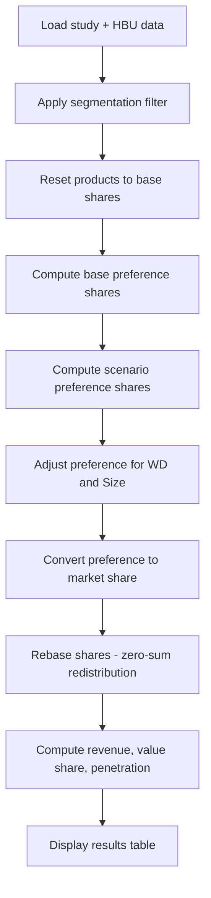

# Market Simulator — Mathematical Model

**Audience:** Business and technical readers who need to understand *what* the simulator calculates and *how*, without a heavy statistics background.

**Scope:** The Python engine in `model/`. It mirrors the original Market Simulator (.NET) logic documented in `decompiled/PORTING_NOTES.md`.

---

## What the simulator does

The Market Simulator answers: **“If we change a product’s price, pack size, availability (WD), or other attributes, how would consumer choices and market outcomes shift?”**

It does this by:

1. Reading **survey respondent data** (HBU file) that captures how different people value product features.
2. Computing each person’s **preference** for each product under base and scenario conditions.
3. Converting those preferences into **market shares** that respect real-world constraints (total market size stays fixed).
4. Deriving **business metrics** — revenue, value share, penetration, and indices vs. base.

Think of it as a **what-if calculator** built on choice modeling, not a forecast of the future on its own.

Everything else (analytics, optimizer, API) re-runs this same pipeline:

**Survey utilities → preference shares → volume shares → revenue / metrics**

---

## Key terms

| Term | Plain-English meaning |
|------|------------------------|
| **Respondent** | One person (or household) from the market research survey. Each has a weight (usually 1). |
| **HBU** | *Household/Respondent By Utility* — spreadsheet of respondent-level utility scores per product and attribute level. |
| **Utility** | A score for how much a respondent likes a product configuration. Higher = more preferred. Can be negative. |
| **Attribute** | A product characteristic: Price, Size, Brand, Flavor, etc. |
| **Discrete attribute** | Picks from named levels (e.g. Brand A / B / C). |
| **Conditional attribute** | Takes numeric values (e.g. Price = 12.50). Utilities are **blended** between calibrated points. |
| **SKU** | The product identity itself — each SKU has its own utility column in HBU. |
| **Preference share** | Share of *stated choice* if everyone picked among included products. Sums to ~100% across included products. |
| **Market share (volume share)** | Volume share after calibration (WD, size, rebasing). Sums to 100% for the modeled universe. |
| **WD (Weighted Distribution)** | How widely the product is available (shelf presence, numeric %). Higher WD = easier to buy. |
| **MSU** | *Market Size Unit* — scaling factor for market size in revenue formulas. |
| **SU** | *Sales Unit* — additional revenue scaling from study design. |
| **VSU** | *Value Sales Unit* — value-weighted measure; an anchor adjusts value share to external market value data. |
| **Exponent factor** | Sensitivity dial on utilities before choice. Higher = more winner-take-all. |
| **Segmentation** | Filter respondents to a subgroup (e.g. “Region = Cairo”) before recalculating shares. |
| **Scenario** | A saved set of attribute/WD changes applied on top of the base study. |
| **MNL** | *Multinomial Logit* — the choice rule that turns utilities into pick-probabilities. |

---

## Pipeline (big picture)

When you change a product or run a scenario, the engine runs these steps in order:



| Step | Module | Entry point | What it does |
|------|--------|-------------|--------------|
| 1 | `attribute_utilities.py` | `AttributeUtilityModel` | Load survey utilities; blend Price/Size between calibrated points |
| 2 | `preference_engine.py` | `compute_preference_shares` | Turn scores into preference share % |
| 3 | `share_calculator.py` | `calculate_new_shares` + rebase | Turn preference into volume share |
| 4 | `metrics.py` | `apply_*_metrics` | Revenue, value share, penetration, indices |

**Code entry point:** `ShareEngine.find_predicted_shares()` / `_run_pipeline` in `model/share_engine.py`, via `ProjectCore`.

Three calculation cores:

1. Utility load / blend — `attribute_utilities`
2. Choice model (MNL) → preference shares — `compute_preference_shares`
3. Preference → volume shares + metrics — `calculate_new_shares` + `metrics`

---

## Formulas

### 1. Build product utility for each person

For each respondent and product, the engine adds utilities from all **included** attributes.

#### Discrete attributes (e.g. Brand, SKU)

The respondent has a fixed utility score for each level. The product’s current level selects which score applies.

**Example:** Brand level 2 → use column `BrandLevel2` for that respondent.

#### Conditional attributes (e.g. Price, Size)

The survey only gives utilities at a few calibrated points. If the scenario value sits between two points, the engine **blends** those utilities:

```text
utility = u₀ + (x − v₀) / (v₁ − v₀) · (u₁ − u₀)
```

Where:

- **v₀, v₁** — calibrated values on the design grid (e.g. price 10 and 12)
- **u₀, u₁** — utilities at those levels for this person and product
- **x** — value used in the scenario (e.g. price = 11.5)
- **utility** — blended score at x

If the scenario value is outside the grid, the engine continues that blend using the first or last pair of points.

**Example:** price points **10** (utility **−2**) and **12** (utility **−4**), scenario price **11** → utility = **−3**.

#### Total product utility

```text
total utility = person weight × (sum of attribute utilities)
```

(The live simulator does this for all people and products at once in `preference_engine`; the idea is the same.)

**Module:** `model/attribute_utilities.py` — class `AttributeUtilityModel`.

---

### 2. Preference shares (MNL)

`preference_engine.compute_preference_shares`

**MNL** means Multinomial Logit: turn each person’s product scores into “what would they pick?” probabilities, then average those into a preference share %.

1. **Build each person’s score for each product**

```text
score[person, product] = sum of that product’s attribute utilities
```

2. **Apply the person’s survey weight**

```text
score[person, product] = score[person, product] × person weight
```

3. **Convert scores to choice probabilities** (only products included in the lineup)

```text
probability[person, product] =
    exp(exponent × score[person, product])
    ÷
    sum over included products of exp(exponent × score[person, other product])
```

Where:

- **exponent** — study setting that makes favorites more or less dominant (`exponent_factor`). Exponent = 1 is neutral; values above 1 sharpen preferences.
- **probability** — chance this person picks that product (between 0 and 1; adds to 1 across included products)

4. **Ignore people outside the selected segment** (their probabilities are set to zero)

5. **Average to a preference share %**

```text
preference share % for product =
    100 × (sum of probabilities for that product) ÷ (number of people in the segment)
```

Preference shares across included products add up to about 100%.

**Business reading:** Preference share answers *“What fraction of choosers would pick this SKU?”* before WD/size/volume calibration.

**Module:** `model/preference_engine.py`.

---

### 3. Volume share

`share_calculator.calculate_new_shares`

Preference share is “who would choose it.” **Volume share** is the market/volume outcome after distribution, pack size, and (for new/replaced items) launch factors.

#### Step A — Adjust preference for availability and size

- **Existing products:**

```text
adjusted preference =
    preference × (new WD ÷ base WD) × (new size ÷ base size)
```

- **New products:**

```text
adjusted preference = preference × (new size ÷ base size)
```

(New products skip the WD ratio here; they use WD in the volume formula later.)

Then rescale so adjusted preferences for included products still add to 100.

Where:

- **WD** — weighted distribution (how widely available the product is)
- **new / base** — scenario vs starting values

#### Step B — Convert adjusted preference into volume share

| Product type | Meaning | Formula |
|--------------|---------|---------|
| Existing | Already on market | `volume share = current volume share × (new preference ÷ current preference)` |
| Replaced product | Replaces another SKU (e.g. reformulation) | `volume share = replaced SKU’s volume share × (replacement’s preference ÷ replaced SKU’s preference)` |
| New product | True new launch | `volume share = preference × WD × consumption calib. × SOR × awareness × repeat ÷ 100` |

Where:

- **Existing** — scale this SKU’s own volume by how its preference moved
- **Replaced product** — linked to the SKU it replaces; it has no own starting volume, so it borrows the replaced SKU’s volume and scales by preference change
- **New product** — no replaced SKU; volume from preference × availability × launch funnel factors
- **consumption calib., SOR, awareness, repeat** — launch inputs on the product
- After that formula, volume share is also multiplied by **promotion calibration**

**Example (existing):** If preference rises 10% relative to current (`new preference ÷ current preference = 1.10`), volume share rises 10% *before* rebasing.

**Example (replaced product):** Old Cola has volume 8% and preference 10%. Cola Zero (replacement) gets preference 12%:

```text
volume share = 8 × (12 ÷ 10) = 9.6
```

#### Step C — Rebase (keep total market size fixed)

Initial share changes rarely sum to exactly the original total market. The engine **rebases** so total volume is preserved — gains in one place come from losses elsewhere.

1. Compute each product’s volume change vs. its reference (own share, or replaced SKU’s share).
2. Split changes into **gainers** and **losers**.
3. If total market grew or shrank, **scale the gainers or losers** so the net change matches zero (relative to total base share).
4. Apply a final scale:

```text
volume share = volume share × (total current volume ÷ total new volume)
```

**Business reading:** Someone has to lose share for someone else to gain. New products and delistings redistribute volume rather than creating a 110% market.

**Module:** `model/share_calculator.py`.

---

### 4. Revenue, value share, and penetration

`metrics.apply_scenario_metrics`

#### Revenue

```text
revenue = MSU × SU × volume share × price ÷ (pack size × 100)
```

Where:

- **MSU** — market size unit (study scaling)
- **SU** — sales unit (study scaling)
- **volume share** — share from step 3
- **price** — scenario price
- **pack size** — size unit used in the revenue formula

Base revenue uses the same formula with base share and base price.

#### Value sales unit (VSU)

```text
VSU = MSU × volume share × price ÷ (100 × pack size)
```

#### Value share

```text
value share = VSU ÷ value share unit × 100

value share unit =
    sum(VSU for included products)
    + VSU_anchor
    − sum(base revenue for included / base products)
```

The **VSU anchor** (from study meta) ties value shares to external market value totals when provided.

**Business reading:** Value share weights products by **money**, not just volume. A premium SKU with small volume can have high value share.

#### Penetration

Penetration links preference × distribution to volume share:

```text
scale = sum(volume share) ÷ sum(preference share × WD)

penetration = preference share × WD × scale
```

**Intuition:** Preference × WD measures “reachable demand.” The scale factor aligns that with actual rebased volume shares.

#### Indices

- **S.Index** = volume share ÷ base volume share  
- **R.Index** = revenue ÷ base revenue  

(Values above 1 mean up vs base; below 1 mean down.)

**Module:** `model/metrics.py`.

---

## Output columns

| Column | Meaning |
|--------|---------|
| **B.Share** | Base (current market) volume share % |
| **N.Share** | New (scenario) volume share % |
| **S.Index** | Share index = N.Share ÷ B.Share (1.0 = unchanged) |
| **Preference Share** | Scenario preference share % |
| **Value Share** | Scenario value share % |
| **Revenue** | Scenario revenue (study currency units, scaled by MSU/SU) |
| **R.Index** | Revenue index = Revenue ÷ BaseRevenue |
| **Penetration** | Household/consumer penetration metric (see formula above) |
| **VSU** | Value sales unit for the product |
| **Base WD / New WD** | Distribution before and after scenario |

Excluded products show **N.Share = 0** but retain **B.Share** for reference.

---

## Scenario edits — what happens when you change inputs

Handled by `model/attribute_engine.py`:

| Edit | Effect |
|------|--------|
| **Price (absolute)** | Sets new price; utilities blended from HBU price levels |
| **Price (+10%)** | Multiplies current scenario price by 1.10 |
| **WD** | Updates weighted distribution; WD = 0 excludes the product |
| **Discrete level** | Switches to another level index (e.g. different flavor) |
| **Include / exclude** | Removes product from choice set; excluded volume is redistributed in rebasing |

Each change triggers a full recalculation through the pipeline above.

---

## Segmentation

When you filter to a segment (e.g. “Age = 18–24”):

1. Only respondents assigned to that segment are marked **selected**.
2. Preference shares are averaged over selected respondents only.
3. The rest of the pipeline runs unchanged.

**Effect:** Shares reflect the sub-market’s preferences, not the full sample.

**Module:** `StudyModel._apply_segmentation_filter()` in `model/study_model.py`.

---

## Product groups

Groups roll up individual SKU shares for reporting (volume rollup only; no separate choice model at group level).

**Module:** `model/groups.py`.

---

## Worked micro-example (existing product, simplified)

Assume a 3-SKU market, one respondent type, exponent = 1, WD and size unchanged.

| Product | Base share | Base pref | Scenario pref |
|---------|------------|-----------|---------------|
| A | 40% | 45% | 50% |
| B | 35% | 35% | 30% |
| C | 25% | 20% | 20% |

**Before rebasing**, product A’s new share:

```text
volume share A = 40% × (50 ÷ 45) = 44.4%
```

Similar calculations for B and C, then **rebase** so total returns to 100%. Products gaining preference take share from those losing it.

---

## Data inputs required

### Design Excel (study.json source)

- Product list with base shares, WD, attributes
- Attribute definitions (discrete vs conditional)
- Conditional level grids per product (for blending)
- Segments, groups, study constants (MSU, SU, VSU, exponent)

### HBU Excel (hbu.parquet source)

Per respondent row:

- `RespondentID`, `RespondentWeight`
- `ProductID1`, `ProductID2`, … — SKU-specific utilities
- `{Attribute}Level1`, `{Attribute}Level2`, … — utilities per attribute level

The engine **does not** invent utilities; it reads them from HBU and combines them according to the scenario attribute values.

---

## What builds on the core

| Higher-level | Uses | Role |
|--------------|------|------|
| `ShareEngine._run_pipeline` | preference → volume → metrics | Primary orchestration |
| `ProjectCore.reload_results` / `find_predicted_shares` | ShareEngine | API / session entry |
| `FastEvaluator` + `optimizer` | Same MNL + calculate_new_shares | Faster path for optimization |
| `analytics/*` | Repeated find_predicted_shares runs | No separate choice model |

Analytics modules (still wrappers around this pipeline):

- `elasticity.py` — how share moves when a level changes
- `fair_share.py` — actual vs proportional redistribution
- `cross_brand.py` — ±10% price probes
- `incremental.py` — intro / removal lineups
- `price_index.py`, `som_sop.py`, `validation.py`

**Important:** `FastEvaluator` must stay aligned with `preference_engine`. It reuses the same volume-share and metrics steps.

### Call chain

```
API / analytics / optimizer
  └─ ProjectCore.find_predicted_shares / reload_results
       └─ ShareEngine._run_pipeline
            ├─ compute_preference_shares (base + scenario)
            ├─ calculate_new_shares (+ rebase)
            └─ apply_scenario_metrics
                 └─ revenue, value share, penetration
```

---

## Code module map

| Step | Python module | Original C# reference |
|------|---------------|------------------------|
| Utility + blending | `attribute_utilities.py` | `Attributes.cs` |
| Preference / MNL choice | `preference_engine.py` | `loadUtilityMatrix`, `getPreferenceShare` |
| WD, size, share, rebase | `share_calculator.py` | `Products.calculateNewShare`, `rebaseNewShare` |
| Attribute edits | `attribute_engine.py` | `changeProductAttributeCombination` |
| Pipeline orchestration | `share_engine.py` | `findPredictedShares` |
| Revenue, value, penetration | `metrics.py` | `setProductsRevenue`, `setProductsValueShare`, `setProductsPenetration` |
| UI / scenarios API | `project_core.py` | `ProjectCore.cs` |
| Groups | `groups.py` | `Groups.cs` |
| Financial (NOS/TDC) | `financial.py` | Stub — not fully ported |
| Optimizer fast path | `fast_evaluator.py` | Same formulas as preference/share engines |

### Function reference

| File | Function | Role |
|------|----------|------|
| `attribute_utilities.py` | `_interpolate` / `attribute_level_utility` | Blend between calibrated levels |
| `preference_engine.py` | `compute_preference_shares` | Scores → choice probabilities → preference % |
| `share_calculator.py` | `calculate_new_shares` | Preference → volume (WD/size/funnel) |
| `share_calculator.py` | `_rebase_new_share` | Conserve total volume |
| `metrics.py` | `apply_base_metrics` / `apply_scenario_metrics` | Revenue, VSU, penetration |

---

## Assumptions and limitations

1. **Independence of irrelevant alternatives (IIA)** — Standard MNL property: relative odds between two products don’t change when a third is added. Inherited from the original simulator.

2. **Linear blending** — Conditional attributes (Price/Size) assume utility moves in a straight line between calibrated points.

3. **Zero-sum market** — Total volume share is conserved (within the defined product set) after rebasing. The model does not forecast category growth.

4. **Segmentation** — Filters respondents; it does not re-weight to population proportions unless the study design encodes that in respondent weights.

5. **Financial metrics (NOS/TDC)** — Placeholder in Python; not yet calculated.

6. **Validation** — Numeric parity with the legacy `.exe` is planned (see `PORTING_NOTES.md` Plan 2) but not yet automated.

---

## Further reading

- **Porting notes & C# cross-reference:** `decompiled/PORTING_NOTES.md`
- **Architecture overview:** `README.md` (Architecture section)
- **Chart Analysis:** `CHART_ANALYSIS.md`
- **Brand Optimizer:** `OPTIMIZER_GUIDE.md`
- **Smoke test:** `python -m scripts.smoke_study` — creates a demo study and checks shares sum to ~100%

---

*Last updated: 2026-07-15 — merged former CORE_CALCULATIONS.md into this doc; reflects Python engine in `share_engine`, `preference_engine`, `share_calculator`, `attribute_utilities`, and `metrics`.*
