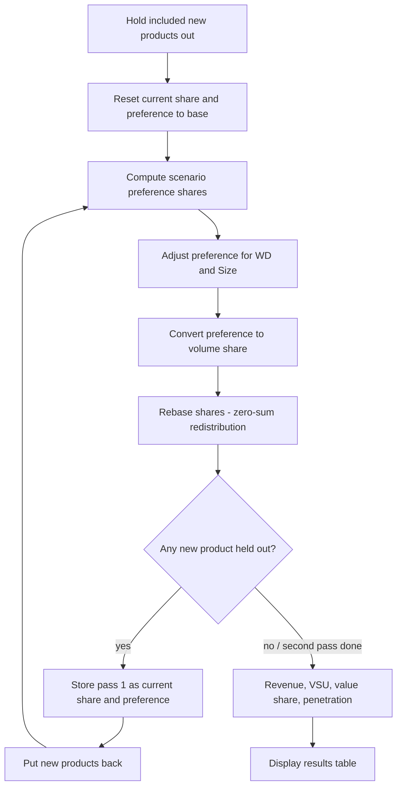

# Market Simulator — Mathematical Model

**Audience:** Business and technical readers who need to understand *what* the simulator calculates and *how*, without a heavy statistics background.

**Scope:** The desktop Market Simulator (.NET) engine, as recovered in [Legacy App Decompiled](Legacy%20App%20Decompiled/). Every formula below is checked against that source. The detailed reference pages ([PREFERENCE.md](PREFERENCE.md), [SHARES.md](SHARES.md), [METRICS.md](METRICS.md)) go further on each step.

---

## What the simulator does

The Market Simulator answers: **“If we change a product’s price, pack size, availability (WD), or other attributes, how would consumer choices and market outcomes shift?”**

It does this by:

1. Reading **survey respondent data** (HBU file) that captures how different people value product features.
2. Computing each person’s **preference** for each product under base and scenario conditions.
3. Converting those preferences into **market shares** that respect real-world constraints (total market size stays fixed).
4. Deriving **business metrics** — revenue, value share, penetration, and indices vs. base.

Think of it as a **what-if calculator** built on choice modeling, not a forecast of the future on its own.

Everything else (Chart Analysis, incremental, scenarios) re-runs this same pipeline:

**Survey utilities → preference shares → volume shares → revenue / metrics**

---

## Key terms

| Term | Plain-English meaning |
|------|------------------------|
| **Respondent** | One person (or household) from the market research survey. Each has a weight (usually 1). |
| **HBU** | *Household/Respondent By Utility* — spreadsheet of respondent-level utility scores per product and attribute level. |
| **Utility** | A score for how much a respondent likes a product configuration. Higher = more preferred. Can be negative. |
| **Attribute** | A product characteristic: Price, Size, Brand, Flavor, etc. |
| **Discrete attribute** | Picks from named levels (e.g. Brand A / B / C). |
| **Conditional attribute** | Takes numeric values (e.g. Price = 12.50). Utilities are **blended** between calibrated points. |
| **SKU** | The product identity itself — each SKU has its own utility column in HBU. |
| **Preference share** | Share of *stated choice* if everyone picked among included products. Sums to 100% across included products. |
| **Market share (volume share)** | Volume share after calibration (WD, size, rebasing). Sums to the base market total. |
| **WD (Weighted Distribution)** | How widely the product is available (shelf presence, numeric %). Higher WD = easier to buy. |
| **MSU** | *Market Size Unit* — scaling factor for market size in revenue formulas. |
| **SU** | *Sales Unit* — additional revenue scaling from study design. |
| **VSU** | *Value Sales Unit* — value-weighted measure; an anchor adjusts value share to external market value data. |
| **Exponent factor** | Sensitivity dial on utilities before choice. Higher = more winner-take-all. |
| **Segmentation** | Filter respondents to a subgroup (e.g. “Region = Cairo”) before recalculating shares. |
| **Scenario** | A saved set of attribute/WD changes applied on top of the base study. |
| **MNL** | *Multinomial Logit* — the choice rule that turns utilities into pick-probabilities. |

---

## Pipeline (big picture)

When you change a product or run a scenario, `ProjectCore.findPredictedShares` runs these steps in order. Base preference shares are **not** recomputed here; they are calculated when the study loads or the segment changes, and reused.



| Step | C# source | What it does |
|------|-----------|--------------|
| 1 | `Attributes.getAttributeLevelUtility` | Look up or blend each attribute’s utility |
| 2 | `ProjectCore.loadUtilityMatrix`, `getPreferenceShare` | Turn scores into preference share % |
| 3 | `Products.calculateNewShare`, `rebaseNewShare` | Turn preference into volume share |
| 4 | `ProjectCore.setProductsRevenue`, `setProductsValueSalesUnit`, `setProductsValueShare`, `setProductsPenetration` | Revenue, value share, penetration |

### Two passes when a new product is included

If any included product is a **NewProduct** (no base share, no product it replaces), the engine runs the share calculation twice:

1. **Pass 1:** new products are taken out of the lineup and shares are calculated without them.
2. **Store pass 1 as the new starting point:**
   - A replaced product writes its new share and preference onto the **SKU it replaces**.
   - Every other included product copies its new share and preference onto its current values.
   - An excluded product whose alternatives (SKUs that replace it) are all excluded gets a current share of **0**.
3. **Pass 2:** new products are put back, and preference plus volume share are calculated again.

So in pass 2, existing products scale from their **pass 1 share**, not from their base share. This gives a new SKU its volume against a market that already contains every other change.

---

## Formulas

### 1. Build product utility for each person

For each respondent and product, the engine adds utilities from all **included** attributes.

#### Discrete attributes (e.g. Brand, SKU)

The respondent has a fixed utility score for each level. The product’s current level selects which score applies.

**Example:** Brand level 2 → use column `BrandLevel2` for that respondent.

#### Conditional attributes (e.g. Price, Size)

The survey only gives utilities at a few calibrated points, and each product has its own grid of points. If the value matches a grid point exactly, that point’s utility is used. If it sits between two points, the engine **blends** those utilities:

```text
utility = u₀ + (x − v₀) / (v₁ − v₀) · (u₁ − u₀)
```

Where:

- **v₀, v₁** — calibrated values on the product’s grid (e.g. price 10 and 12)
- **u₀, u₁** — utilities at those levels for this person and product
- **x** — value used in the scenario (e.g. price = 11.5)
- **utility** — blended score at x

**Out of range is an error, not an extrapolation.** If the value is below the first grid point or above the last one, the utility is undefined and the engine stops with *“<product> has a base level out of boundry values”*. Edits are bounded to the grid to avoid this (see [EDITS.md](EDITS.md)).

**Example:** price points **10** (utility **−2**) and **12** (utility **−4**), scenario price **11** → utility = **−3**.

#### Total product utility

```text
score[person, product] = person weight × (sum of included attribute utilities)
```

The weight multiplies the score **inside** the choice formula below. It is not used to weight the average in step 2.

---

### 2. Preference shares (MNL)

`loadUtilityMatrix` → `getPreferenceShare`

**MNL** means Multinomial Logit: turn each person’s product scores into “what would they pick?” probabilities, then average those into a preference share %.

1. **Convert scores to choice probabilities** (only products included in the lineup)

```text
probability[person, product] =
    exp(exponent × score[person, product])
    ÷
    sum over included products of exp(exponent × score[person, other product])
```

Where:

- **exponent** — study setting that makes favorites more or less dominant (`ExponentFactor`). Exponent = 1 is neutral; values above 1 sharpen preferences.
- **probability** — chance this person picks that product (between 0 and 1; adds to 1 across included products)

2. **Average over the selected segment** (respondents outside it are skipped)

```text
preference share % for product =
    100 × (sum of probabilities for that product over selected people) ÷ (number of selected people)
```

This is a simple average: every selected respondent counts once, whatever their weight.

**Business reading:** Preference share answers *“What fraction of choosers would pick this SKU?”* before WD/size/volume calibration.

See [PREFERENCE.md](PREFERENCE.md) for details.

---

### 3. Volume share

`Products.calculateNewShare`

Preference share is “who would choose it.” **Volume share** is the market/volume outcome after distribution, pack size, and (for new items) launch factors.

#### Step A — Adjust preference for availability and size

- **Existing and replaced products:**

```text
adjusted preference =
    preference × (new WD ÷ base WD) × (new size ÷ base size)
```

- **New products:**

```text
adjusted preference = preference × (new size ÷ base size)
```

(New products skip the WD ratio here; they use WD in the volume formula later.)

Then rescale so adjusted preferences for included products add to 100.

**The adjusted value replaces the preference share.** From here on, the “Preference Share” column and the penetration formula both use this WD- and size-adjusted value, not the raw MNL result from step 2.

Where:

- **WD** — weighted distribution (how widely available the product is)
- **new / base** — scenario vs starting values

#### Step B — Convert adjusted preference into volume share

| Product type | Meaning | Formula |
|--------------|---------|---------|
| Existing | Already on market | `volume share = current volume share × (new preference ÷ current preference)` |
| Replaced product | Replaces another SKU (e.g. reformulation) | `volume share = replaced SKU’s current share × (replacement’s preference ÷ replaced SKU’s current preference)` |
| New product | True new launch | `volume share = preference × WD × consumption calib. × SOR × awareness × repeat ÷ 100` |

Where:

- **current** — the base value, or the pass 1 value when the two-pass rule above applies
- **Existing** — scale this SKU’s own volume by how its preference moved
- **Replaced product** — linked to the SKU it replaces; it has no own starting volume, so it borrows the replaced SKU’s volume and scales by preference change
- **New product** — no replaced SKU; volume from preference × availability × launch funnel factors
- **consumption calib., SOR, awareness, repeat** — launch inputs on the product
- After that formula, every volume share is also multiplied by **promotion calibration**

**Example (existing):** If preference rises 10% relative to current (`new preference ÷ current preference = 1.10`), volume share rises 10% *before* rebasing.

**Example (replaced product):** Old Cola has volume 8% and preference 10%. Cola Zero (replacement) gets preference 12%:

```text
volume share = 8 × (12 ÷ 10) = 9.6
```

#### Step C — Rebase (keep total market size fixed)

`Products.rebaseNewShare`

Initial share changes rarely sum to exactly the original total market. The engine **rebases** so total volume is preserved — gains in one place come from losses elsewhere.

1. **Total current volume** = sum of current share over **all** products, included or not.
2. **Change per included product** = new share − reference, where the reference is its own current share, or the replaced SKU’s current share for a replacement.
3. Add up the **gains** (positive changes) and the **losses** (negative changes). An excluded product that still has current share counts as a loss of its whole share. A replacement adds back the replaced SKU’s share, so swapping one SKU for another isn’t counted as a loss.
4. **Net change** = sum of new shares for included products − total current volume.
   - If net > 0, each gain is scaled by `|losses ÷ gains|`.
   - If net < 0, each loss is scaled by `|gains ÷ losses|`.
   - The product’s new share = reference + scaled change.
5. Final scale on every included product:

```text
volume share = volume share × (total current volume ÷ sum of new shares for included products)
```

**Business reading:** Someone has to lose share for someone else to gain. New products and delistings redistribute volume rather than creating a 110% market.

See [SHARES.md](SHARES.md) for details.

---

### 4. Revenue, value share, and penetration

`setProductsRevenue` → `setProductsValueSalesUnit` → `setProductsValueShare` → `setProductsPenetration`

#### Revenue

```text
revenue = MSU × SU × volume share × price ÷ (pack size × 100)
```

Where:

- **MSU** — market size unit (study scaling)
- **SU** — sales unit (study scaling)
- **volume share** — share from step 3
- **price** — scenario price (only refreshed when the study has a `Price` attribute)
- **pack size** — the product’s size unit

Base revenue uses the same formula with base share and base price.

#### Value sales unit (VSU)

```text
VSU = MSU × volume share × price ÷ (100 × pack size)
```

#### Value share

```text
value share = VSU ÷ value share unit × 100

value share unit =
    sum(VSU for included products)
    + VSU_anchor
    − sum(base revenue for base-included products)
```

The **VSU anchor** (from study meta) ties value shares to external market value totals when provided.

**Units quirk:** the formula subtracts base *revenue* (which includes SU) from a total of *VSU* (which doesn’t). The two only share units when SU = 1. This is how the legacy engine computes it.

**Business reading:** Value share weights products by **money**, not just volume. A premium SKU with small volume can have high value share.

#### Penetration

Penetration links preference × distribution to volume share:

```text
scale = sum(volume share) ÷ sum(adjusted preference share × new WD)

penetration = adjusted preference share × new WD × scale
```

Both sums are over included products, and “adjusted preference share” is the value from step 3A.

**Intuition:** Preference × WD measures “reachable demand.” The scale factor aligns that with actual rebased volume shares.

#### Indices

- **S.Index** = volume share ÷ base volume share
- **R.Index** = revenue ÷ base revenue
- **VS.Index** (group and company rows only) = value share ÷ base value share

(Values above 1 mean up vs base; below 1 mean down.) On the company total row, R.Index divides by company base revenue.

See [METRICS.md](METRICS.md) for details, including NOS, TDC and company MM$.

---

## Output columns

| Column | Meaning |
|--------|---------|
| **B.Share** | Base (current market) volume share % |
| **N.Share** | New (scenario) volume share % |
| **S.Index** | Share index = N.Share ÷ B.Share (1.0 = unchanged) |
| **Preference Share** | Scenario preference share %, after the WD and size adjustment |
| **B.P.Share** | Base preference share % |
| **Value Share** | Scenario value share % |
| **Revenue** | Scenario revenue (study currency units, scaled by MSU/SU) |
| **R.Index** | Revenue index = Revenue ÷ BaseRevenue |
| **Penetration** | Household/consumer penetration metric (see formula above) |
| **VSU** | Value sales unit for the product |
| **Base WD / New WD** | Distribution before and after scenario |

Excluded products show **N.Share = 0** but retain **B.Share** for reference.

---

## Scenario edits — what happens when you change inputs

| Edit | Effect |
|------|--------|
| **Price (absolute)** | Sets new price; utilities blended from HBU price levels |
| **Price (+10%)** | Multiplies current scenario price by 1.10 |
| **WD** | Updates weighted distribution; WD = 0 excludes the product |
| **Discrete level** | Switches to another level index (e.g. different flavor) |
| **Include / exclude** | Removes product from choice set; excluded volume is redistributed in rebasing |

Each change triggers a full recalculation through the pipeline above. See [EDITS.md](EDITS.md).

---

## Segmentation

When you filter to a segment (e.g. “Age = 18–24”):

1. Only respondents assigned to that segment are marked **selected**.
2. Preference shares are averaged over selected respondents only.
3. The rest of the pipeline runs unchanged.

**Effect:** Shares reflect the sub-market’s preferences, not the full sample. See [SEGMENTS.md](SEGMENTS.md).

---

## Product groups

Groups roll up individual SKU shares for reporting (volume rollup only; no separate choice model at group level). See [GROUPS.md](GROUPS.md).

---

## Worked micro-example (existing products)

Assume a 3-SKU market, exponent = 1, WD and size unchanged.

| Product | Base share | Base pref | Scenario pref |
|---------|------------|-----------|---------------|
| A | 40% | 45% | 50% |
| B | 35% | 35% | 30% |
| C | 25% | 20% | 20% |

**Before rebasing:**

```text
A = 40 × (50 ÷ 45) = 44.44   change +4.44
B = 35 × (30 ÷ 35) = 30.00   change −5.00
C = 25 × (20 ÷ 20) = 25.00   change  0
```

**Rebase:** the new shares sum to 99.44, so net < 0 and losses are scaled by `|4.44 ÷ −5.00| = 0.889`. B’s change becomes −4.44, so B = 30.56. The total is now 100, so the final scale is 1.

| Product | N.Share |
|---------|---------|
| A | 44.44% |
| B | 30.56% |
| C | 25.00% |

---

## Data inputs required

### Design Excel

- Product list with base shares, WD, attributes
- Attribute definitions (discrete vs conditional)
- Conditional level grids per product (for blending)
- Segments, groups, study constants (MSU, SU, VSU, exponent)

### HBU Excel

Per respondent row:

- `RespondentID`, `RespondentWeight`
- `ProductID1`, `ProductID2`, … — SKU-specific utilities
- `{Attribute}Level1`, `{Attribute}Level2`, … — utilities per attribute level

The engine **does not** invent utilities; it reads them from HBU and combines them according to the scenario attribute values. See [DESIGN_FILES.md](DESIGN_FILES.md) and [STUDY_DATABASE.md](STUDY_DATABASE.md).

---

## What builds on the core

Chart Analysis, incremental and scenario comparisons all call `findPredictedShares` repeatedly with different lineups or attribute values. None of them has its own choice model. See [charts/README.md](charts/README.md) and [SCENARIOS.md](SCENARIOS.md).

### Call chain

```
UI / Chart Analysis / scenarios
  └─ ProjectCore.getPredictedSharesDatatable
       └─ ProjectCore.findPredictedShares
            ├─ loadPreferenceShare("NewPreferenceShare")   (loadUtilityMatrix → getPreferenceShare)
            ├─ Products.calculateNewShare                   (→ rebaseNewShare)
            ├─ second pass of both, if a new product is included
            └─ setProductsRevenue → setProductsValueSalesUnit → setProductsValueShare → setProductsPenetration
```

---

## Code map

| Step | C# source |
|------|-----------|
| Utility + blending | `Attributes.getAttributeLevelUtility`, `interpolateUtiltiy` |
| Preference / MNL choice | `ProjectCore.getProductUtility`, `loadUtilityMatrix`, `getPreferenceShare` |
| WD, size, share, rebase | `Products.calculateNewShare`, `rebaseNewShare` |
| Pipeline orchestration | `ProjectCore.findPredictedShares` |
| Revenue, value, penetration | `ProjectCore.setProductsRevenue`, `setProductsValueSalesUnit`, `setProductsValueShare`, `setProductsPenetration` |
| Results grid | `ProjectCore.fillProductDisplayResultRow` |
| Groups | `Groups.cs` |

---

## Assumptions and limitations

1. **Independence of irrelevant alternatives (IIA)** — Standard MNL property: relative odds between two products don’t change when a third is added.

2. **Linear blending, no extrapolation** — Conditional attributes (Price/Size) assume utility moves in a straight line between calibrated points. Values outside a product’s grid are an error.

3. **Zero-sum market** — Total volume share is conserved after rebasing. The model does not forecast category growth.

4. **Segmentation** — Filters respondents; it does not re-weight to population proportions. Respondent weights scale utilities, not the preference average.

5. **Value share units** — Base revenue (with SU) is subtracted from a VSU total (without SU); see the units quirk above.

---

## Further reading

- **Detailed pages:** [README.md](README.md) lists every legacy page.
- **Porting notes & C# cross-reference:** [PORTING_NOTES.md](Legacy%20App%20Decompiled/PORTING_NOTES.md)
- **Decompiled source:** [MarketSimulator.Model](Legacy%20App%20Decompiled/MarketSimulator.Model/)
